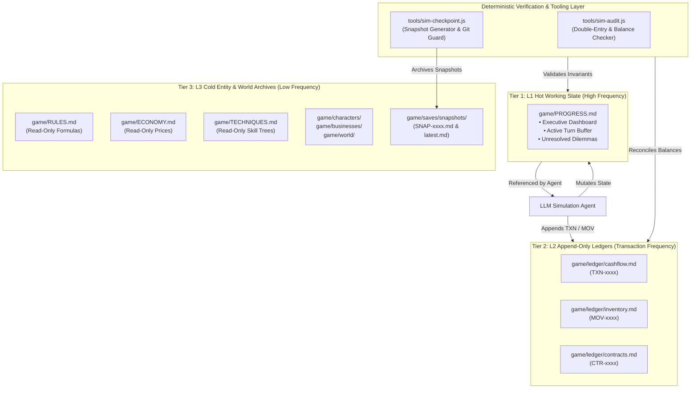
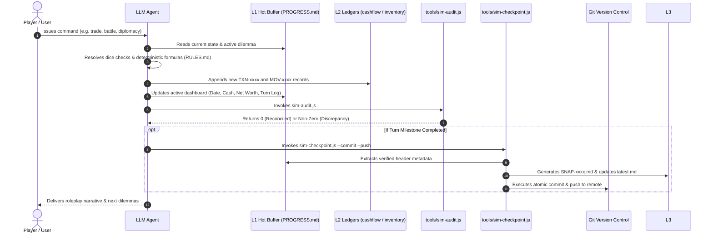

# Simulation Engine Architecture Specification

This document defines the technical architecture, memory model, and deterministic state verification pipelines of the **ThreeKingdoms-AgentEngine**.

---

## 1. Architectural Motivation & Problem Statement

Large-scale agentic simulations face two fundamental constraints when operated over Large Language Models (LLMs):

1. **Context Window Inflation & Reasoning Latency**:
   As a simulation progresses over dozens of turns, loading hundreds of entity dossiers, historical chronicles, and transaction ledgers into every turn's context window degrades inference latency ($O(N)$ token cost) and causes "needle-in-a-haystack" attention decay.
2. **Mathematical Hallucination & Drift**:
   Generative models excel at narrative reasoning and qualitative drama, but are prone to subtle arithmetic drift in financial accounting, inventory balances, and scrap rate calculation over extended sessions.

**Solution**: A **Decoupled 3-Tier Memory Architecture** paired with **Deterministic External Auditor Tools** (written in lightweight Node.js), ensuring zero mathematical drift, sub-second invariant validation, and minimal LLM token consumption.

---

## 2. System Overview & The 3-Tier Memory Model



### Detailed Tier Specifications

| Tier | Path | Access Pattern | Token Footprint | Responsibilities |
|---|---|---|---|---|
| **L1 (Hot)** | `game/PROGRESS.md` | Read/Write (Every Turn) | ~1,000 - 1,500 tokens | Single source of truth during live gameplay. Tracks active date, location, liquid money, total net worth, active dilemmas, and turn log. |
| **L2 (Ledger)** | `game/ledger/` | Append-Only | Variable (Offloaded) | Immutable audit trails for cashflow (`TXN-`), warehouse stock transfers (`MOV-`), contract milestones (`CTR-`), and audit baseline reconciliations. |
| **L3 (Cold)** | `game/characters/`<br/>`game/world/`<br/>`game/saves/` | Read-Only (On-Demand) | Static storage | Granular entity dossiers (`player.md`, `NPC-xxxx.md`), geography (`LOC-xxxx.md`), historical snapshots (`SNAP-xxxx.md`), and immutable rulebooks (`RULES.md`, `ECONOMY.md`). |

---

## 3. Data Flow & Turn Execution Pipeline

Each simulation turn executes across four deterministic phases:



---

## 4. Invariant Rules & Deterministic Auditor

The engine's accounting integrity is enforced by mathematical invariants in `tools/sim-audit.js`:

### 1. Cashflow Double-Entry Equation
$$\text{Closing Cash} = \text{Opening Cash} + \sum \text{Inflow} - \sum \text{Outflow}$$
- Every copper coin (`Qian`) in circulation must be accounted for.
- Discrepancy between calculated cash and the final reported balance in `cashflow.md` must be exactly **0 Qian**.

### 2. Physical Inventory Conservation
$$\text{Stock}_{\text{Current}} = \text{Stock}_{\text{Initial}} + \sum \text{Produced} + \sum \text{Purchased} - \sum \text{Consumed} - \sum \text{Sold}$$
- Materials (bamboo, timber, iron, leather, salt, grain) cannot materialize out of thin air.
- Scrap and defect losses are logged and subtracted explicitly.

### 3. Hot Buffer Synchronization
The figures in `game/PROGRESS.md` (`Liquid Capital`, `Strategic Grain`, `Total Net Worth`) must match the closing sums in `game/ledger/cashflow.md` and `game/businesses/BIZ-0001.md`.

---

## 5. Tooling Reference Manual

### `tools/sim-audit.js`
Zero-dependency Node.js CLI script that parses Markdown tables and verifies all financial and stock invariants.
- **Run command**:
  ```bash
  node tools/sim-audit.js
  ```
- **Output on success**:
  ```text
  ====================================================
   ⚡ ThreeKingdoms-AgentEngine: Autonomous Auditor
  ====================================================
  [1] CASHFLOW DOUBLE-ENTRY AUDIT:
      Transactions Verified: 12
      Final Closing Cash   : 15,940 Qian
      ✅ PASSED: Cash balance equation reconciled exactly (0 discrepancy).
  [2] PHYSICAL INVENTORY AUDIT:
      Tracked Items in Warehouse: 11 items
      Stock Movement Records    : 2 entries
      ✅ PASSED: Physical inventory reconciled (0 discrepancy).
  [3] HOT BUFFER (PROGRESS.md) RECONCILIATION:
      ✅ PASSED: PROGRESS.md dashboard matches ledgers exactly.
  ====================================================
   🟢 OVERALL AUDIT VERDICT: 100% RECONCILED / ZERO DEFECT
  ====================================================
  ```

### `tools/sim-checkpoint.js`
Automated state archiver that chains invariant verification, snapshot serialization, and atomic version control.
- **Usage**:
  ```bash
  node tools/sim-checkpoint.js [options] [optional_note]
  ```
- **Options**:
  - `--commit`: Performs atomic git commit of game state files using the semantic git guard.
  - `--push`: Pushes new checkpoint commits directly to the remote repository.
- **Behavior**:
  1. Runs `sim-audit.js`. If audit fails, aborts immediately to prevent saving corrupted states.
  2. Parses the executive metadata from `game/PROGRESS.md`.
  3. Increments snapshot counter (`SNAP-0000`, `SNAP-0001`, ..., `SNAP-0005.md`) in `game/saves/snapshots/`.
  4. Overwrites `game/saves/latest.md` with the latest summary pointer.
  5. If `--commit` is specified, triggers `git-safe-commit`.

---

## 6. Cold Start & Multi-Agent Compatibility

Any external AI agent or human player can resume the simulation without prior context by following this cold-start protocol:

1. **Read L1 Hot Buffer**:
   Load `game/PROGRESS.md` to acquire the active campaign date, protagonist location, current cash, and active dilemmas.
2. **Read Active Checkpoint Pointer**:
   Load `game/saves/latest.md` to inspect the verified snapshot ID and rule versions.
3. **Execute Invariant Verification**:
   Run `node tools/sim-audit.js` to ensure the current repository state is 100% reconciled before taking player input.
4. **On-Demand Rule Lookup**:
   Load `game/RULES.md` and `game/ECONOMY.md` **only** when computing dice check modifiers, crafting scrap rates, or market prices.
