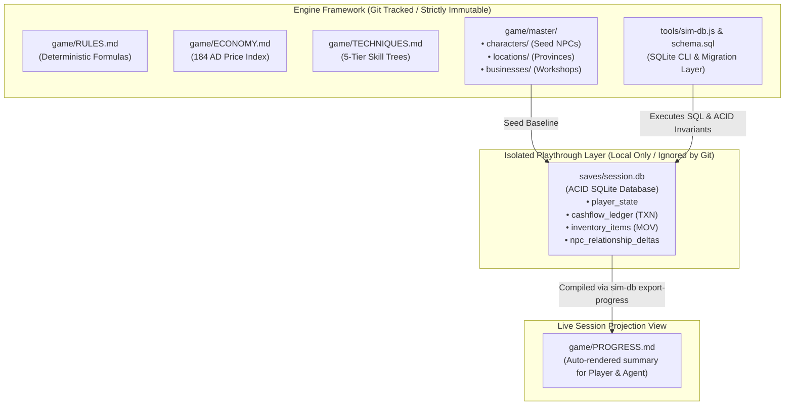

# Simulation Engine Architecture Specification

This document defines the technical architecture, decoupled storage model, and deterministic SQLite verification engine of the **ThreeKingdoms-AgentEngine**.

---

## 1. Architectural Philosophy: Engine vs. Playthrough Decoupling

A critical architectural distinction governs this system:

- **The Git Repository is Strictly an Engine Framework**:
  Git stores only the core rules, deterministic formulas, master seed data (Year 184 AD initial canvas), and CLI tools.
- **Playthrough Sessions are Isolated Locally**:
  All player saves, character progression, transaction logs, and SQLite database files are strictly ignored by `.gitignore`. This ensures that playing a campaign never pollutes or mutates the core framework, allowing infinite replays, multi-character campaigns, and branching timelines.

---

## 2. Decoupled Hybrid CQRS Architecture

The engine employs a **Command Query Responsibility Segregation (CQRS)** pattern with an embedded SQLite engine for transactional writes and an auto-projected Markdown dashboard for human inspection:



### Component Roles & Access Patterns

| Component | Storage Type | Git Status | Access Pattern | Responsibilities |
|---|---|---|---|---|
| **Core Rules** (`RULES.md`, `ECONOMY.md`, `TECHNIQUES.md`) | Markdown | **Tracked** | Read-Only | Mathematical formulas, DCs, commodity price index, skill progression ladders. |
| **Master Seeds** (`game/master/`) | Markdown | **Tracked** | Read-Only | Immutable baseline state of China in Month 2, 184 AD (characters, locations, starter workshops). |
| **Session DB** (`saves/session.db`) | SQLite | **Ignored** | Read/Write (ACID) | High-speed transactional storage for active campaign: double-entry cashflow, inventory, and NPC deltas. |
| **Progress View** (`game/PROGRESS.md`) | Markdown | **Ignored** | Write-Projected | Single aggregated hot buffer compiled from SQLite for human reading and Agent context. |
| **Progress Template** (`game/PROGRESS.template.md`) | Markdown | **Tracked** | Reference | Blueprint showing the format of an initialized progress buffer. |

---

## 3. SQLite Schema & Invariant Enforcement

All dynamic campaign state is maintained in `saves/session.db` using the schema defined in `tools/schema.sql` (audited across 193 invariants):

1. **`player_state`**: Tracks attributes (INT, POL, WAR, LDR, DIP, COM, LOG, CRA), current location, liquid cash, safe cash, fixed capital, grain, and net worth.
2. **`cashflow_ledger`**: Strict double-entry ledger enforcing:
   $$\text{Closing Balance} = \text{Opening Balance} + \sum \text{Inflow} - \sum \text{Outflow}$$
3. **`account_journal`**: Balanced double-entry financial journal ($Debit == Credit$) categorizing operational expenses, revenues, signing bonuses, and war spoils.
4. **`inventory_items` & `stock_movements`**: Enforces physical conservation of goods (bamboo, grain, weapons, salt, leather).
5. **`session_settlements`**: 20 historical Three Kingdoms citadels with authoritative garrisons, wall defenses (10-100), granaries, and treasuries.
6. **`master_routes`**: 24 strategic connecting routes classified by 4 terrain profiles (`HIGHWAY`, `WATERWAY`, `MOUNTAIN_PASS`, `PLANK_ROAD`).
7. **`trade_caravans`**: Long-distance expedition caravans with route transit progression, guard retinue tiers, and settlement liquidation.
8. **`businesses` & `npc_state`**: Enterprise operations boosted by hired auxiliary specialists (+15% to +25% efficiency multipliers).
9. **`npc_relationship_deltas`**: Stores relational shifts (Affinity, Respect) relative to master character seed dossiers.

---

## 4. Why SQLite Outperforms Raw Markdown Files for State Tracking

1. **Sub-Millisecond Execution**: SQLite queries execute in <1ms without file parsing or disk thrashing.
2. **Zero Regex Fragility**: Eliminates syntax errors caused by pipe delimiter misalignment, commas in numbers, or line-ending mismatches.
3. **90%+ LLM Token Savings**: Instead of feeding 10 separate markdown tables to the LLM, the agent executes targeted queries (`SELECT cash, location FROM player_state`) returning only the requested row.
4. **Multi-Campaign Isolation**: To start a new campaign or character, simply initialize a new database (`saves/campaign_02.db`) without touching engine files.

---

## 5. Tooling Reference: `tools/sim-db.js`

The engine provides a zero-dependency CLI bridge to SQLite (`tools/sim-db.js`):

```bash
# Initialize a new session
node tools/sim-db.js init [campaign_id] [character_name]

# Check current campaign status and net worth
node tools/sim-db.js status

# Execute targeted SQL query
node tools/sim-db.js query "SELECT * FROM cashflow_ledger ORDER BY txn_id DESC LIMIT 3;"

# Re-compile and export game/PROGRESS.md
node tools/sim-db.js export-progress
```
