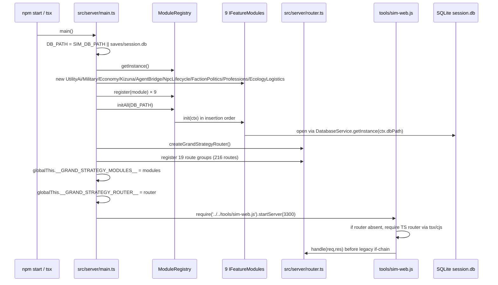

# 01 — Repository Inventory

**Snapshot:** branch `feat/remaining-systems`, commit `069cd8c`, 2026-11-03.
**Method:** directory walk, `package.json` and config inspection, entry-point reading, live schema query on `saves/session.db`, and execution of the repository's own `route-shadow-report`.

Evidence tags: **[V]** verified, **[I]** inferred, **[P]** proposed, **[?]** unknown.

---

## 1. What kind of system this is

This is **not** a .NET solution. There are no `.sln`, `.csproj`, assemblies, or DI containers. It is a single Node.js package (Node `>=26`) written in TypeScript and CommonJS JavaScript, with:

- a TypeScript feature-module layer under `src/modules/` (39,612 lines),
- a legacy CommonJS simulation engine under `engine/` (6,588 lines),
- a zero-dependency HTTP gateway under `tools/sim-web.js` (3,547 lines),
- two browser clients: a Vite/TypeScript slice layer (`src/client/`) and a frozen legacy script layer (`public/js/`, 17,820 lines),
- a SQLite database (`saves/session.db`) with 125 tables and 89 numbered migrations,
- an MCP stdio server (`src/mcp/`),
- a verification platform under `tools/` and `tests/` (38,756 lines combined).

The only runtime dependency is `better-sqlite3` `^13.0.3`. Dev dependencies are `tsx`, `typescript`, `vite`, `@types/node`, `@types/better-sqlite3`. **[V]** (`package.json`)

---

## 2. Top-level layout

| Path | Files / lines | Role | Evidence |
| --- | --- | --- | --- |
| `src/core/` | 5 files | Kernel primitives: DB service, event bus, registry, RNG, domain types | [V] |
| `src/modules/` | 16 domain folders, 39,612 lines | Business modules and controllers | [V] |
| `src/shared/` | 33 files, 2,577 lines | Cross-module contracts: ledger, time, constants, IDs, projections, market quote | [V] |
| `src/server/` | 2 files, 459 lines | Composition root and framework-free HTTP router | [V] |
| `src/client/` | 17 feature folders + core | TypeScript browser slices, modal shell, API client | [V] |
| `src/mcp/` | 3 files, 538 lines | MCP JSON-RPC server over stdio | [V] |
| `engine/` | 42 files, 6,588 lines | Legacy simulation core, 18 TS bridge adapters, time/task/travel managers | [V] |
| `public/js/` | 21 files, 17,820 lines | Legacy browser UI (frozen by architecture guard) | [V] |
| `public/dist/` | 4 files | Built client bundle (ES + IIFE + maps) | [V] |
| `tools/` | 125 files, 19,195 lines | Dev CLI, migrations, audit, golden contracts, scaffold | [V] |
| `tests/` | 122 files, 19,561 lines | 108 modern suites + 4 legacy suites + fixtures | [V] |
| `config/` | 5 JSON files | Game constants, pricing, prestige, duel, scenario seeds | [V] |
| `game/` | Markdown projections | Human-readable state, not source of truth | [V] (ADR-001) |
| `saves/` | SQLite files | `session.db`, `master.db`, backups, legacy.json | [V] |
| `docs/` | 2 audits + guides | Existing documentation | [V] |
| `.github/workflows/` | 1 workflow | CI: verify + audit + client bundle | [V] |

Root documentation is substantial: `ARCHITECTURE.md` (59 KB), `PROJECT.md` (27 KB), `README.md` (31 KB), `DECISIONS.md` (47 KB, ADR-001…ADR-054+), `CHANGELOG.md` (174 KB), `TEST_INFRA.md`, `TEST_READY.md`, `PROGRESS.md`, `HANDOFF.md`, `KNOWN_ISSUES.md`, `PLAN.md`. **[V]**

---

## 3. Entry points and executables

| Entry | Command | Transport | Starts what | Evidence |
| --- | --- | --- | --- | --- |
| `src/server/main.ts` | `npm start`, `npm run dev` (`tsx watch`) | HTTP :3300 | Bootstraps 9 modules, builds router, then `require('../../tools/sim-web.js').startServer(PORT)` | [V] `main.ts:66-141` |
| `tools/sim-web.js` | required by the above; also directly runnable | HTTP | Static files + 49 legacy API handlers; delegates matching routes to `__GRAND_STRATEGY_ROUTER__` | [V] `sim-web.js:245-270`, `3492+` |
| `src/mcp/server.ts` | `npm run mcp` | JSON-RPC 2.0 over stdio | MCP tools for agents | [V] |
| `tools/sim-db.js` | `node tools/sim-db.js …` | CLI | DB init, SQL, status, projection | [V] |
| `tools/migrations/run.js` | `npm run migrate` | CLI | Applies numbered migrations | [V] |
| `tools/test-runner.js` | `npm test` | CLI | 4 legacy + 108 modern suites | [V] |
| `vite` | `npm run dev:client`, `npm run build:client` | Browser | Builds `src/client/main.ts` to `public/dist/` | [V] `vite.config.mts` |
| `tests/*` | direct `tsx` | CLI | Verification suites | [V] |

There is **no** `bin` field and no compiled server output: the server runs through `tsx` at runtime, and the browser is the only bundled artifact. **[V]**

---

## 4. Bootstrap sequence

Key observations:

1. **Registration is compile-time and hardcoded.** `main.ts:52-68` constructs nine concrete classes; `main.ts:91-111` calls 19 `register*Routes` functions. There is no manifest, scan, or config list. **[V]**
2. **Initialization is ordered by array insertion, not by dependency.** `ModuleRegistry.initAll` iterates `Map` insertion order (`module-registry.ts:46-54`). **[V]**
3. **Failure policy is all-or-nothing.** Any module `init` throw aborts bootstrap (`module-registry.ts:50-53`). **[V]**
4. **The legacy gateway can boot without the modular layer.** It catches the `tsx/cjs` require failure and continues with only legacy handlers (`sim-web.js:231-240`). **[V]**
5. **Global service locator is part of the boot contract.** `globalThis.__GRAND_STRATEGY_MODULES__`, `__GRAND_STRATEGY_ROUTER__`, `__DAILY_INTERACTION_ENGINE__`, `__CONTEXT_ACTION_ENGINE__` are the integration surface for the legacy layer. **[V]**

---

## 5. Module inventory

### 5.1 Registered `IFeatureModule` implementations (9)

| Module ID | Class | Lines (folder) | Owns routes? | Init does |
| --- | --- | --- | --- | --- |
| `module.utility-ai` | `UtilityAiModule` | 117 | No | Nothing; ignores context |
| `module.military` | `MilitaryModule` | 5,544 | Yes, via free function | Opens DB, loads supply graph from `master_routes`, subscribes `WORLD_DAY_TICK` (no-op) |
| `module.economy` | `EconomyModule` | 4,055 | Yes, via free function | Nothing |
| `module.social-kizuna` | `KizunaModule` | 3,098 | Yes, via free functions | Stores context only |
| `module.agent-bridge` | `AgentBridgeModule` | 198 | No | Opens DB, **creates table** `npc_episodic_memories`, preloads 100 memories, subscribes `HISTORICAL_EVENT_RESOLVED` |
| `module.npc-lifecycle` | `NpcLifecycleModule` | 895 | No | Opens DB, ensures baseline progressions, subscribes `WORLD_MONTH_TICK` |
| `module.faction-politics` | `FactionPoliticsModule` | 1,327 | Yes, read-only controller | Stores context, subscribes `TURN_ADVANCED` |
| `module.professions` | `ProfessionsModule` | 7,576 | Yes, via free functions | Stores context |
| `module.ecology-logistics` | `EcologyLogisticsModule` | 2,654 | Yes, via free functions | Opens DB, seeds bandit strongholds/caravans/crises when empty, subscribes `TURN_ADVANCED` |

Evidence: `src/modules/*/*.module.ts`, `grep "implements IFeatureModule"`.

### 5.2 Domain folders without a module class (7)

| Folder | Lines | Routes | Why it matters |
| --- | --- | --- | --- |
| `market` | 3,055 | 21 (stall 6, warehouse 7, freight 4, merchant 4) | A full DLC candidate with no lifecycle object |
| `progression` | 2,843 | 15 | Owns skills/perks/talents/fame/quests, initialised lazily by singletons |
| `lineage-succession` | 4,033 | 19 | Owns all `family_*` tables; no module class |
| `life` | 528 | 2 | Single table; no module class |
| `equipment` | 499 | 0 direct | Service only; no controller |
| `contextual-actions` | 2,105 | 0 direct | Aggregator used by server/global |
| `instances` | 1,085 | 5 (in legacy gateway, not modular router) | Session lifecycle; single-active-DB policy |

Evidence: route counts measured by counting `router.<verb>(`; folder sizes by `wc -l`.

### 5.3 Module start-up side effects

| Module | DB access in `init` | Schema DDL in `init` | Event subscription |
| --- | --- | --- | --- |
| agent-bridge | Yes | **Yes** (`npc_episodic_memories`) | `HISTORICAL_EVENT_RESOLVED` |
| military | Yes | No | `WORLD_DAY_TICK` (no-op) |
| npc-lifecycle | Yes | No | `WORLD_MONTH_TICK` |
| faction-politics | Yes (via service) | No | `TURN_ADVANCED` |
| ecology-logistics | Yes | No | `TURN_ADVANCED` |
| others | No / lazily | No | — |

**[V]** — the DDL-in-`init` is an explicit violation of ADR-020 ("Runtime Schema Is Migration-Owned").

---

## 6. HTTP surface

| Surface | Count | Evidence |
| --- | --- | --- |
| Modular router routes | 216 | count of `router.get/post/put/delete/patch(` |
| Modules with a route registrar | 19 functions across 20 files | `grep "export function register.*Routes"` |
| Legacy if-chain handlers | 49 | `node tools/route-shadow-report.js` |
| Shadowed modular routes | 0 | same |
| Distinct `/api/...` strings in legacy gateway | 53 | static scan |
| API golden contracts | 28 | `node tools/api-golden.js` (ran in verify mode) |
| Inline `onclick=` handlers in `index.html` | 64 | `grep -o` |

Largest route owners: `economy.controller.ts` (40), `military.controller.ts` (22), `lineage.controller.ts` (19), `professions.controller.ts` (19), `duel.controller.ts` (18), `progression.controller.ts` (15), `banquet.controller.ts` (14), `blacksmith-forge.service.ts` (11).

The router is a 318-line, dependency-free matcher with `registerRoute`, `get/post/put/delete/patch`, `mount`, `matches`, and `handle` (`src/server/router.ts:146-318`). It is a genuine platform primitive that currently lives under `src/server/` and is imported by every controller, which inverts the intended dependency direction.

---

## 7. Data stores

| Store | Size | Role | Owner |
| --- | --- | --- | --- |
| `saves/session.db` | ~4 MB + WAL | Active campaign, 125 tables | Runtime |
| `saves/master.db` | 397 KB | Master catalog blueprint | Content pipeline + runtime dual-write |
| `saves/instances/*.db` | varies | Per-instance databases | `InstanceManagerService` |
| `saves/backups/` | varies | Backups before reset/migration | Tools |
| `saves/legacy.json` | 204 B | NG+ legacy record | `src/shared/legacy-store.ts` |
| `game/**/*.md` | projections | Human-readable state | `engine/projector.js` |
| `config/*.json` | 5 files | Constants and domain tables | Shared |

Runtime schema facts:

- 125 user tables; `schema_migrations` tracks the 89 numbered migrations. **[V]**
- `PRAGMA foreign_keys=ON`, `journal_mode=WAL`, `busy_timeout=5000` in both drivers. **[V]**
- Master/session separation is real but leaky: `master_*` tables exist in both files, and `ContextDialogueService` writes both at runtime. **[V]**
- No tenant/instance column exists; campaign identity is the database file itself. **[V]**

---

## 8. Client composition

| Layer | Files | Lines | Loading |
| --- | --- | --- | --- |
| TS core | 5 (`api`, `events`, `modal-shell`, `ui`) | 890 | Bundled by Vite |
| TS features | 17 folders | 7,245 | Bundled; exposed on `window` via `legacy-bridge.ts` |
| Legacy scripts | 21 | 17,820 | 21 `<script>` tags, execution order matters |
| Shell | `index.html` + `styles.css` + `app.js` | 13,932 | Inline `onclick` + globals |

`legacy-bridge.ts` is the compatibility layer: it aliases TS modals onto `window.LineageFamilyUI`, `window.EquipmentUI`, `window.EnterpriseUI`, etc., while leaving several legacy-owned modals untouched (`legacy-bridge.ts:52-72`). **[V]**

The architecture guard freezes the legacy file count at 21 (`tools/arch-baseline.json`, rule `legacy-ui-script-count`). **[V]**

---

## 9. Configuration and environment

| Variable / file | Effect | Evidence |
| --- | --- | --- |
| `SIM_DB_PATH` | Selects the campaign database at boot | `main.ts:44`, `database.ts:44` |
| `PORT` | HTTP port, default 3300 | `main.ts:134` |
| `SIM_MASTER_DB_PATH` | Master DB for tests | `tests/verify-strategic-world-map.ts:22` |
| `config/game-constants.json` | Currency, grain, calendar (30-day months), fatigue, EXP curve | shared constants test |
| `config/market-pricing.json`, `battle-duel.json`, `prestige.json`, `scenario-seeds.json` | Domain tables | read by services |

There is no `.env` loader, no secret store, no auth configuration, and no CORS restriction (`Access-Control-Allow-Origin: *` in `sendJson`). **[V]**

---

## 10. Build, test, and deployment

| Stage | Command | What runs |
| --- | --- | --- |
| Typecheck | `npm run typecheck` | `tsc --noEmit` over `src`, `tests`, Vite config |
| Architecture lint | `npm run lint` | 10 rules against `tools/arch-baseline.json` |
| Client syntax | `npm run lint:client` | legacy script parse check |
| UI consistency | `npm run lint:ui` | styles/modal checks |
| Anti-slop | `npm run lint:slop` | forbidden labels/units |
| API contract lint | `npm run lint:api` | client calls vs server routes |
| Route shadowing | `npm run routes:shadow` | 216 modular vs 49 legacy, 0 dead |
| Tests | `npm test` | 4 legacy + 108 modern suites |
| Golden API | `npm run golden:verify` | 28 endpoint contracts |
| Write smokes | `npm run smoke:write` | write-path smoke checks |
| Invariants | `npm run audit` | `tools/sim-audit.js` |
| Client bundle | `npm run build:client` | Vite lib build to `public/dist` |

CI (`.github/workflows/*.yml`) runs `npm ci`, bootstraps the ignored database with `ingest-markdown-master.js` + `sim-db.js init`, then `npm run verify`, `npm run audit`, and `npm run build:client` on Node 26. **[V]**

There is no container, systemd unit, reverse proxy config, or cloud manifest in the repository. Deployment is "run the Node process with a `SIM_DB_PATH`". **[V]**

---

## 11. Third-party and external dependencies

| Dependency | Scope | Risk |
| --- | --- | --- |
| `better-sqlite3` | Runtime | Native module; ABI tied to Node version; only runtime dependency |
| `tsx` | Dev/runtime loader | Required because the server executes `.ts` directly; production depends on a dev dependency |
| `vite` / `typescript` | Build | Standard |
| Google Fonts CDN | Browser | External network dependency in `index.html` |
| `sqlite3` CLI | CI legacy tests | Installed by CI because some legacy suites shell out |

No message broker, HTTP client library, ORM, DI container, auth library, or logging framework exists. **[V]**

---

## 12. Inventory conclusions

1. **The repository is structurally richer than a typical monolith**: 16 domain folders, 216 routes, 125 tables, 108 modern verification suites plus 4 legacy suites.
2. **Its "modules" are façade objects**, not deployment units: 9 lifecycle objects coexist with 7 domain folders that have no lifecycle object (4 of them own HTTP routes; 3 are service/aggregator folders).
3. **Its composition is code, not configuration**: the boot path names every module and every route registrar.
4. **Its integration surface is global**: `globalThis` carries modules and router into the legacy gateway, and engine managers read that global to publish events.
5. **Its data layer is shared and co-written**: 30 tables have multiple writers; `player_state` has 12.
6. **Its client is two applications in one page**: a bundled TS layer and a frozen 21-script legacy layer.

These six facts define the entire extraction program. The next document quantifies the dependency damage.

---

## 13. Open questions

| ID | Question | Why it matters | Status |
| --- | --- | --- | --- |
| Q-01 | Is the legacy `public/js` layer allowed to shrink by replacement, or must it stay byte-compatible? | Determines UI DLC boundaries | [?] |
| Q-02 | Is one campaign per server process a permanent product constraint? | Determines whether runtime isolation is ever needed for business DLC | [?] (latest commit suggests yes, temporarily) |
| Q-03 | Is `master.db` a build artifact or a runtime store? | Determines whether runtime dual-write must be removed | [?] (currently both) |
| Q-04 | Are there commercial licensing requirements for DLC? | Determines whether the license layer is real or a stub | [?] |
| Q-05 | What is the supported Node/OS matrix for deployment? | Affects `better-sqlite3` and `tsx` choices | [?] |
