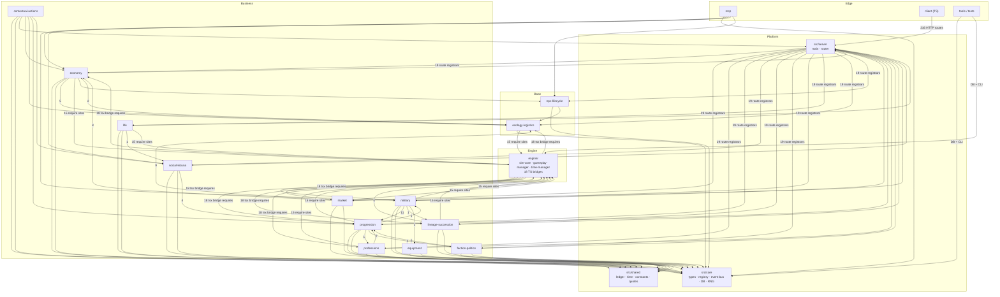
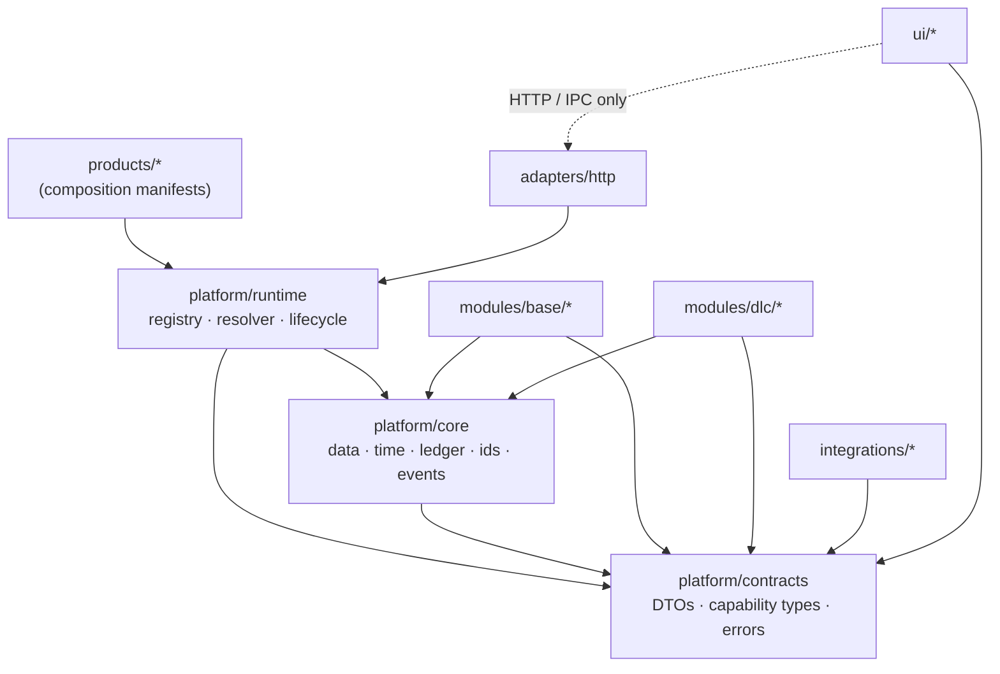

# 02 — Dependency Analysis

**Method.** All `.ts`, `.mts`, and `.js` files under `src/` and `engine/` were scanned for static `import ... from` and `require(...)` specifiers. Relative specifiers were resolved to files, grouped into units (`modules/<domain>`, `shared`, `core`, `server`, `engine`, `client/*`, `mcp`, `tools`), and counted. Dynamic `require('../../engine/...')` calls are included; `require` of the same unit is excluded. Counts are **import-site counts**, not fan-in metrics.

Limitations: conditional requires inside `try` blocks are counted once; re-exports are counted; test and tooling imports are excluded from the module graph unless stated. **[V]** for counts, **[I]** for architectural interpretation.

---

## 1. Current dependency graph (module level)

**Reading the graph:** every business module depends on `shared` and `core`; almost every module also imports `server/router` (omitted from most arrows to keep the diagram readable). The bidirectional arrows between `engine` and the module layer, and between `market`/`economy`/`ecology-logistics`, are the structural problems.

---

## 2. Highest-volume edges

| From → To | Import sites | Assessment |
| --- | --- | --- |
| `modules/market` → `shared` | 41 | Normal use of contracts |
| `modules/professions` → `shared` | 38 | Normal, but 44 written tables indicate a large aggregate |
| `engine` → `core` | 25 | Adapter layer loading TS kernel |
| `modules/military` → `shared` | 24 | Normal |
| `modules/professions` → `core` | 21 | Mostly `DatabaseService.getInstance` |
| `modules/economy` → `shared` | 20 | Normal |
| `modules/ecology-logistics` → `shared` | 18 | Normal |
| `shared` → `core` | 17 | Normal |
| `modules/military` → `core` | 16 | Direct DB access |
| `modules/progression` → `shared` | 15 | Normal |
| `modules/progression` → `core` | 14 | Direct DB access |
| `modules/market` → `core` | 14 | Direct DB access |
| `modules/economy` → `core` | 13 | Direct DB access |
| `modules/military` → `modules/progression` | 11 | **Business-to-business cycle** |
| `modules/lineage-succession` → `shared` | 13 | Normal |
| `modules/market` → `modules/ecology-logistics` | 9 | **Business-to-business coupling** |

---

## 3. Cycles and bidirectional coupling

### C1. `engine` ↔ `src/modules` (the dominant cycle) — [V]

- Engine → modules: 18 lazy bridge files. Each calls `require('tsx/cjs')` and then imports a TypeScript service. Example: `engine/prestige-bridge.js:11-18`; similar in `ai-war-bridge.js`, `siege-bridge.js`, `merchant-bridge.js`, `stall-bridge.js`, `freight-bridge.js`, `lineage-bridge.js`, `settlement-market-bridge.js`, `condition-bridge.js`, `contract-board-bridge.js`, `farm-bridge.js`, `fame-attraction-bridge.js`, `battle-duel-bridge.js`, `field-battle-bridge.js`, `obligation-bridge.js`, `retainer-loyalty-bridge.js`, `expedition-bridge.js`, `victory-bridge.js`.
- Modules → engine: 15 `require`/`import` sites for `time-manager`, `career-paths`, `date-utils`, `action-time`.

**Why it exists:** the engine owns the turn loop and month close; the modules own newer business rules. Rather than moving the loop, the loop calls into TS via bridges.

**Consequence:** you cannot build, test, or ship "the engine" without the TypeScript module tree, and you cannot build a module without the engine's clock/date functions. Any DLC extraction that ignores this will produce a package that still needs the whole legacy engine.

**Direction to resolve:** make `engine/time-manager`, `action-policy`, `date-utils`, `career-paths`, and `rules` part of **Core** (they are mechanisms, not business), then let the engine's remaining old code depend on Core and on module capabilities. The 18 bridges become capability calls, not file imports. This is the single most important refactor for DLC independence.

### C2. `market` ↔ `economy` ↔ `ecology-logistics` — [V]

- `market/npc-market.service.ts:16-17`, `freight.service.ts:16-21`, `merchant-company.service.ts:15-16` import `SettlementMarketService` and `RegionalMarketService` from `economy`.
- `economy/settlement-market.service.ts:13`, `contract-board.service.ts:18`, `intel.service.ts:13`, `economy.controller.ts:14-17` import `spatial-registry` and `CaravanLogisticsService` from `ecology-logistics`.
- `ecology-logistics/caravan-logistics.service.ts:20-22` imports `SettlementMarketService` and `RegionalMarketService` from `economy`.

This is a genuine three-node cycle: price query needs geography; geography needs price; logistics needs both.

**Direction to resolve:** extract the *pure* parts into contracts: `world.geography.resolve(locationId)` and `market.price.quote(item, location, date)`. The services can still be separate modules; only the DTO boundary moves.

### C3. `military` ↔ `progression` — [V]

- `military` → `progression`: 11 imports (skills, prestige, conditions integration).
- `progression/progression.controller.ts:20` imports `ConditionService` from `military`.

**Direction:** combat should publish `condition.injured` events or call `condition.apply` capability; progression should consume. A controller importing a military service is a layering violation (controller should not be a cross-module integration point).

### C4. `progression` ↔ `faction-politics` — [V]

- `faction-politics/faction-politics.module.ts:10` imports `PrestigeService`.
- `faction-politics/faction.controller.ts:14` imports `SpatialGuardService` from progression.
- `progression` imports faction data for career paths (2 sites).

**Direction:** fame/prestige is a progression capability; political office should award it via `progression.fame.award`. Spatial guard is a world capability, not progression.

### C5. `professions` ↔ `progression` — [V]

- `professions` → `progression`: 7 sites (`SkillService`, `PrestigeService`).
- `progression` → `professions`: 1 site (career path reads profession state).

**Direction:** skill EXP is core progression; career paths should be a read model composed from profession + skill + faction data, not a module dependency.

### C6. `engine`/`shared`/`modules` triangle — [V]

- `src/shared/action-time.ts:54` requires `engine/time-manager`.
- `src/shared/skill-exp.ts` documents a mirrored engine constant.
- `src/shared/projection-sync.ts:19` resolves `engine/projector`.
- `src/shared/business-succession.ts:10` imports `modules/ecology-logistics/spatial-registry`.
- One engine import of `shared` exists (`engine -> shared` 1 site).

**Consequence:** `shared` is not a leaf contract layer; it is a second hub that knows about both the engine and a business module. This is why "shared" cannot simply become `Platform/Contracts`.

### C7. Client: no cycle, but two hubs — [V]

The TypeScript client is acyclic: `main.ts` → `features/*` → `core/*`. Two feature folders act as hubs:

- `legacy-bridge.ts` imports 11 feature slices and exposes them on `window`.
- `grand-command-hub.modal.ts` imports 7 feature slices.

No `core → feature` edge exists. This is a positive finding: the TS client core is genuinely reusable. The problem is that the legacy script layer bypasses it via 64 inline `onclick` handlers and globals.

---

## 4. Layer violations with exact evidence

| # | Violation | Evidence | Impact |
| --- | --- | --- | --- |
| L1 | Business controllers import the HTTP transport | 20 controller files import `Router, sendJson, RouteContext` from `src/server/router` | DLC cannot be hosted without the web layer |
| L2 | A service file is also a controller | `src/modules/professions/blacksmith-forge.service.ts:25` | Lifecycle and transport entangled |
| L3 | Modules mutate another module's aggregate | `src/modules/market/npc-market.service.ts:205`, `economy/promissory-note.service.ts:106`, `progression/exploration.service.ts:138`, `social-kizuna/tavern-banquet.service.ts:414` | No ownership; removal is unsafe |
| L4 | `shared` imports a business module | `src/shared/business-succession.ts:10` → `modules/ecology-logistics/spatial-registry` | Shared layer cannot be reused without a DLC |
| L5 | `shared` imports the engine | `src/shared/action-time.ts:54`, `projection-sync.ts:19` | Shared layer cannot be reused without legacy runtime |
| L6 | Server composition root imports 19 concrete registrars | `src/server/main.ts:20-39, 93-110` | No product selection |
| L7 | Legacy gateway depends on `globalThis` state | `tools/sim-web.js:245-270`, `engine/time-manager.js:56-60`, `engine/gameplay-manager.js:545` | Hidden runtime contract; test and production differ |
| L8 | Engine managers call module methods through the global object | `engine/gameplay-manager.js:505-528` (`gsm.npcLifecycle`, `gsm.factionPolitics`, …) | Modules cannot be swapped or isolated |
| L9 | Runtime DDL in a module | `src/modules/agent-bridge/agent-bridge.module.ts:47-57` | Migration ownership broken |
| L10 | Runtime write to the master database | `src/modules/social-kizuna/context-dialogue.service.ts:216-235` | Master data is not immutable; dual-file consistency risk |

---

## 5. Static and global state inventory

| Kind | Count | Examples | Risk |
| --- | --- | --- | --- |
| Singleton classes (`private static instance`) | 38 | `DatabaseService`, `ModuleRegistry`, `EventBus`, 35 services | Hidden lifetime; hard to test in parallel |
| `static getInstance` accessors | 39 | same | Service locator |
| Direct `DatabaseService.getInstance(...)` sites | 100 | modules and engine bridges | Module cannot receive a differently scoped DB |
| `globalThis` writes in `src` | 4 (arch-guard budget) | `__GRAND_STRATEGY_MODULES__`, `__GRAND_STRATEGY_ROUTER__`, `__DAILY_INTERACTION_ENGINE__`, `__CONTEXT_ACTION_ENGINE__` | Process-wide mutable registry |
| `globalThis` reads in `engine` | 3 files | `time-manager.js`, `gameplay-manager.js`, `sim-web.js` | Production wiring depends on an undocumented shape |
| `window.*` globals in legacy UI | 30+ identifiers | `MapLiveService`, `apiSpendActionTime`, `CaravanUI`, `UI`, `currentScene` | UI DLC cannot be loaded in isolation |

The architecture guard measures only `src` for `global-service-locator` (baseline 4). The engine's reads are not counted, which is why the event-bus breakage (F3) was not caught.

---

## 6. Dependency classification

Per the requested taxonomy:

| Class | Definition | Current examples | Health |
| --- | --- | --- | --- |
| **Core Dependency** | Module → kernel primitive | all modules → `src/core/database`, `src/shared/ledger`, `src/shared/action-time` | Healthy in direction, too coarse in surface |
| **Module Dependency** | Module → another module's domain logic | `market` → `economy`, `military` → `progression` | Unhealthy (cycles, concrete services) |
| **Infrastructure Dependency** | Module → DB/filesystem/HTTP client | 100 `DatabaseService.getInstance`, `fs` in services, `fetch` in MCP | Acceptable, but should be mediated by repository/UoW |
| **UI Dependency** | Module → DOM/browser globals | only `src/client`; modules are DOM-free | **Healthy** — no business module imports DOM |
| **External Dependency** | Third-party package | `better-sqlite3`, Google Fonts, `tsx` | Low surface |
| **Cross-Module Dependency** | Read or write of another module's tables | 30 multi-writer tables | Unhealthy (see `07-data-ownership.md`) |

---

## 7. Target dependency rules

The target is an acyclic, inward-pointing graph. These rules are enforceable with a dependency-cruiser-style check or an extension of `tools/arch-guard.js`.

| Rule | Statement | Enforcement |
| --- | --- | --- |
| R1 | `contracts` depends on nothing (types only) | compile check: no imports outside contracts |
| R2 | `core` may depend on `contracts` only | dependency scan |
| R3 | base modules may depend on `contracts` + `core`; **not** on DLC | dependency scan |
| R4 | DLC may depend on `contracts` + `core` + declared base capabilities; **not** on another DLC's source | manifest + dependency scan |
| R5 | integrations depend on contracts only; they call capabilities | dependency scan |
| R6 | UI depends on contracts and HTTP/IPC clients only | dependency scan |
| R7 | No module imports `adapters/http` except its own `controller.ts`; controllers are registered by the module | module contract |
| R8 | No module writes a table it does not own | SQL ownership guard |
| R9 | No `globalThis` in `src/modules` or `src/shared` | arch-guard (already 4/0; extend to engine) |
| R10 | No `require()` of TypeScript from `engine` except through a declared adapter interface | dependency scan |

---

## 8. Prioritised dependency fixes

| Priority | Fix | Effort | Unblocks |
| --- | --- | --- | --- |
| P0 | Fix event bus ownership (give `ModuleRegistry` a public `context`, or inject an `EventPublisher` into `ModuleContext`; remove `globalThis` discovery) | 1 day | Any event-based contract; F3 |
| P0 | Move `Router` type into `platform/contracts` (or a `transport` contract) so controllers do not import the server | 1–2 days | Transport-neutral DLC |
| P1 | Make `time-manager`, `date-utils`, `action-policy`, `career-paths` part of Core and expose them through a typed facade | 3–5 days | Breaks cycle C1 for the most-used functions |
| P1 | Replace cross-module service imports with capability calls: `market`→`economy` price quote, `military`→`progression` skill/fame, `professions`→`progression` skill | 5–8 days | DLC independence |
| P2 | Remove `shared → modules` and `shared → engine` edges | 2–3 days | Reusable contracts package |
| P2 | Replace 100 direct `DatabaseService.getInstance` calls with injected `DbSession` per module | 5–10 days | Ownership + testability; can be incremental |
| P3 | Replace `globalThis.__GRAND_STRATEGY_MODULES__` with a small kernel handle passed to the legacy gateway | 2–3 days | Removes hidden runtime contract |

Effort figures are estimates **[P]**; they are not measured.

---

## 9. Conclusion

The repository has **good vertical boundaries and bad horizontal ones**:

- The 16 domain folders are a credible DLC map.
- The `shared`/`core` layer is a credible kernel seed.
- But the dependency graph is cyclic in four places, the engine and modules are mutually dependent, the transport is embedded in business modules, and the runtime is wired through globals.

Therefore the extraction program must begin with **edge repair (contracts + transport + event delivery + ownership)** before it begins with **module splitting**. Splitting first would produce packages that still import each other, which is modularization in name only.
