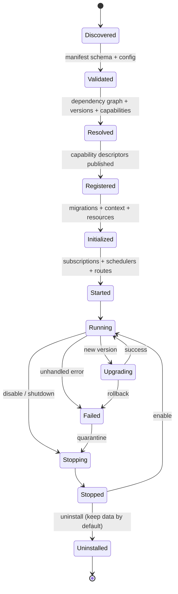

# 06 — Runtime & Lifecycle

**Purpose:** decide what kind of runtime each module needs, and define a lifecycle that can survive install, failure, upgrade, and removal.

---

## 1. Runtime facts today

| Fact | Evidence | Consequence |
| --- | --- | --- |
| One Node process serves HTTP and simulation | `src/server/main.ts:120-141` | No process isolation between modules |
| TypeScript is executed by `tsx`, not compiled | `package.json` scripts; `engine/*-bridge.js` call `require('tsx/cjs')` | Production depends on a dev dependency; startup cost |
| One active database path per process | `DB_PATH = SIM_DB_PATH or saves/session.db` (`main.ts:44`); `sim-web.js:256-266` returns 409 for other paths | Multi-campaign requires one process per campaign |
| `DatabaseService` can open several paths | `src/core/database.ts:38-62` | Capacity exists, but the HTTP layer does not route by path |
| Modules initialize in insertion order | `module-registry.ts:46-54` | No dependency ordering |
| Module init may perform DDL and DB queries | `agent-bridge.module.ts:47-57` | Boot is not side-effect free; failure can leave partial schema |
| Events are discovered through `globalThis` | `time-manager.js:56-60`, `gameplay-manager.js:545` | Delivery is broken in production (F3) |
| The MCP server is a separate stdio process | `src/mcp/server.ts:1-30` | The only real Level 3 runtime in the repository |
| No hot reload, no process manager, no container | repository scan | Deployment is a manual Node process |

---

## 2. Runtime options

### 2.1 Embedded runtime (same process)

| Aspect | Assessment |
| --- | --- |
| Applicability | **Recommended for all base modules and business DLC** |
| Cost | Lowest: no serialization, no network, shared transaction |
| Technical limits | Shared failure domain; one event loop; one DB connection per path |
| Dependencies | Core runtime, capability broker |
| Communication | Typed method calls through the broker |
| Error handling | Typed `Result`; a provider failure can fail the caller's transaction |
| Lifecycle | `init` → `start` → `stop`; no process supervision needed |
| Why it fits | The game is single-player, latency-sensitive, and relies on one ACID SQLite transaction that spans money, inventory, and time |

**All current modules are embedded today.** Keeping them embedded is not a compromise; it is the correct choice for this product.

### 2.2 Isolated runtime (separate process)

| Aspect | Assessment |
| --- | --- |
| Applicability | `int.mcp` (already), optional `int.agent-bridge` |
| Cost | Medium: process supervision, serialization, failure mapping, duplicate config |
| Technical limits | Cannot join the main SQLite transaction; must use commands or outbox |
| Dependencies | IPC (stdio/HTTP), capability schema, idempotency keys |
| Communication | JSON-RPC or HTTP; the same capability DTOs |
| Error handling | Timeouts, retries, circuit breaker, dead-letter |
| Lifecycle | Supervisor restarts; main process treats it as optional |
| When to use | Long-running external I/O (LLM calls), untrusted extensions, independent scaling |

**Do not** move `market`, `professions`, `military`, or any module that writes player cash/inventory into a separate process. It would turn one atomic transaction into a distributed transaction for no benefit.

### 2.3 Distributed runtime (multiple machines)

| Aspect | Assessment |
| --- | --- |
| Applicability | **Not recommended** |
| Cost | High: service discovery, auth, observability, distributed consistency |
| Technical limits | SQLite is a single-host embedded database; cross-machine writes require replacing the store |
| Evidence of need | None found: single-player, one campaign per process, no multi-tenant requirement |
| Decision | Revisit only if the product becomes multi-player or server-authoritative multiplayer |

---

## 3. Runtime selection per module

| Module | Runtime | Reason |
| --- | --- | --- |
| Core (data/time/ledger/kernel) | Embedded | Must be in-process to own the transaction |
| `base.player`, `base.world`, `base.npc`, `base.content` | Embedded | Shared aggregates; read by most DLC |
| `dlc.economy`, `market`, `professions`, `progression`, `social`, `lineage`, `politics`, `military`, `life`, `equipment` | Embedded | Transactional gameplay |
| `int.mcp` | Isolated | Already stdio; tool clients are external |
| `int.agent-bridge` | Embedded now; isolated optional | Only if LLM latency/retries dominate |
| `ui.web-ts`, `ui.web-legacy` | Browser | Separate by nature |
| `platform.instances` | Embedded (process management) | Controls database files and restart |
| `platform.tooling` | Build/CI | Never shipped |

---

## 4. Proposed lifecycle

### Stage responsibilities

| Stage | What happens | Failure policy |
| --- | --- | --- |
| **Discover** | Read manifests from the product manifest, a directory, or a package list | Unknown/invalid manifest → reject module, continue others |
| **Validate** | Schema, config, `apiVersion`, table ownership conflicts | Invalid → reject; required module → boot fails |
| **Resolve** | Build graph; topological sort; check versions, cycles, missing capabilities | Cycle or missing required capability → boot fails with a precise list |
| **Register** | Publish capability descriptors; reserve route prefixes; declare tables | Duplicate capability/table/route → reject |
| **Initialize** | Run pending migrations for this module; construct services; open scoped DB | Failure → roll back that module's migrations; mark failed |
| **Start** | Subscribe to events, register routes, start schedulers | Failure → `stop` the module and mark failed |
| **Running** | Serve calls | Provider error → typed error; repeated failure → circuit breaker (optional) |
| **Stop** | Unsubscribe, cancel timers, flush buffers | Best effort; log failures |
| **Disable** | Stop, keep data and registration record | Re-enable without reinstall |
| **Upgrade** | Validate new manifest; run additive migrations; swap provider | Failure → restore previous version and DB backup |
| **Uninstall** | Remove code and registration; keep tables by default | Data removal only by explicit `--purge` |

### Boot order

1. Core (config, DB, clock, ledger, ids, events, ownership registry).
2. Base modules in dependency order (`base.content` → `base.world` → `base.player` → `base.npc`).
3. Business DLC in dependency order, honoring the product manifest.
4. Integrations (optional; may fail without blocking the product).
5. UI assets (independent of server boot).
6. Start HTTP/MCP adapters last, after all routes are registered.

---

## 5. Installed vs Enabled vs Licensed

These are three independent facts and must not be conflated:

| State | Meaning | Stored where | Effect |
| --- | --- | --- | --- |
| **Installed** | Code and migrations are present on disk | Filesystem / package registry | Can be enabled; no runtime effect |
| **Enabled** | Selected by the product manifest and started | Product manifest / runtime state | `init`/`start` run; capabilities available |
| **Licensed** | Entitlement permits use in this product | License file or signed token (**[P]**; does not exist today) | Without a license, an enabled module refuses to start with `LICENSE_REQUIRED` |

Today only "installed and hardcoded" exists. There is no enable/disable and no license concept. **[V]**

**Recommendation:** implement Installed and Enabled now; implement Licensed only if the product has a commercial DLC plan. Do not build a licensing server for a single-player game.

---

## 6. Failure scenarios

| Scenario | Detection | Behaviour | Data safety |
| --- | --- | --- | --- |
| Module `init` throws | Exception during initialize | Roll back that module's migrations; if required → abort boot; if optional → mark disabled with reason | Transaction per migration; DB backup before upgrade |
| Required dependency missing | Resolve stage | Fail boot with `{missing: ['base.player']}` | No writes |
| Dependency version incompatible | Resolve stage | Fail boot with required vs available versions | No writes |
| Capability missing at call time | Broker | `CAPABILITY_UNAVAILABLE`; UI shows "DLC not enabled" | No partial write: validate before mutation |
| Runtime error inside provider | Typed error | Caller transaction rolls back; event logged with correlation ID | ACID |
| Recurring provider failure | Failure counter | Disable optional module; required module stops the server | State consistent at last commit |
| Upgrade migration fails | Migration transaction | Restore DB backup; keep old code active | Backup + transaction |
| Rollback after upgrade | Operator command | Restore code version and DB backup; run reverse migration only if additive | Backup mandatory |
| Uninstall with data | Operator command | Remove registration and routes; keep tables | Default keep |
| Core version incompatible | Validate stage | Refuse module with `CORE_API_INCOMPATIBLE` | No writes |
| Partial boot (HTTP starts before modules) | Boot order | Forbidden: adapters start last | — |
| Event handler throws | Publisher | Log with envelope ID; do not fail the producer if the event is not transactional | Business state already committed |

**Principle:** a module may fail; the **ledger and player inventory may not**. Any module whose failure can leave money or goods inconsistent must run in the caller's transaction and fail it.

---

## 7. Upgrade strategy

Use **expand → migrate → contract** for every module upgrade:

1. **Expand:** add new tables/columns/capabilities; keep old ones working.
2. **Migrate:** backfill data in a module-owned migration; verify invariants.
3. **Contract:** remove old fields/capabilities after all consumers move; bump major.

Rules:

- Migrations are additive within a minor version.
- A module may only migrate its own tables. The runner records `module_id` in `schema_migrations`.
- Before any upgrade: backup `session.db` (the instance service already has a backup pattern).
- A destructive migration requires an explicit flag and a verified backup.
- Rollback is restore-backup + previous code; reverse migrations are not assumed.

---

## 8. Uninstall and data retention

| Policy | Behaviour |
| --- | --- |
| Default uninstall | Remove code, routes, capabilities, subscription; keep tables and rows |
| Reinstall | Reuses existing tables; runs no destructive migration |
| Purge | Explicit operator action; drops module tables after backup |
| Foreign keys | Module tables must not be referenced by another module's FKs; use IDs and contracts |
| Orphan data | Allowed by design; a disabled DLC leaves inert rows |

This is only safe if data ownership is enforced (`07-data-ownership.md`). Today, uninstalling `market` would break `player_state` writers in other modules.

---

## 9. Hot reload

**Not recommended.** Reasons:

- SQLite connections and prepared statements are held per module.
- Module `init` currently performs DDL and data reads.
- Reloading a provider mid-transaction can expose two implementations of the same capability.
- The verification gate is the safe place to test a new module, not the live server.

If developer ergonomics require it, use `tsx watch` on the whole server (already the dev workflow) rather than per-module hot reload.

---

## 10. Multi-campaign runtime

The current product constraint is **one active campaign per server process**. Two supported patterns:

| Pattern | How | When |
| --- | --- | --- |
| One process per campaign | `SIM_DB_PATH=saves/instances/<id>.db PORT=<port>` | Current product, LAN/single player |
| Switch campaign by restart | Reset in place via `POST /api/game/new-session` with backup | Title screen new/continue |

A future per-request `x-session-id` + `AsyncLocalStorage` design is technically possible with `DatabaseService.getForPath`, but it requires scoping every singleton and every module context. It is **not** required for Core/DLC extraction and should not block it.

**Runtime rule:** a module receives a `DbSession`, never a global path. That keeps the door open for per-request scoping later without redesigning modules.

---

## 11. Implementation plan for the runtime

| Phase | Deliverable | Verification |
| --- | --- | --- |
| R0 | Expose `ModuleRegistry.context`; inject `EventPublisher`; remove `globalThis` discovery | New test asserts `WORLD_DAY_TICK` without a fake global |
| R1 | `ModuleManifest` + validator + topological resolver, used only for logging at first | Resolver unit tests; boot order log matches dependency order |
| R2 | `registerRoutes` on the module contract; move `market` routes | 21 routes still reachable; route-shadow 0 |
| R3 | `DbSession` scoped per module; ownership manifest | Ownership guard reports 0 foreign writes for `market` |
| R4 | Optional modules and `failurePolicy: disable` | Boot with `dlc.market` disabled; all other endpoints work |
| R5 | Upgrade path with backup + module migration namespace | Upgrade fixture test |
| R6 | Product manifest drives module selection | Three manifests boot three module sets |

Each phase is behind a feature flag or an additive code path until the gate is green.

---

## 12. Runtime verdict

| Question | Answer |
| --- | --- |
| Is an embedded runtime enough? | **Yes**, for every gameplay module. |
| Which module needs isolation? | `int.mcp` (already isolated); `int.agent-bridge` only if LLM I/O becomes a latency/failure problem. |
| Is distributed runtime needed? | **No.** No evidence, high cost, breaks the single-file ACID model. |
| Is hot reload needed? | **No.** `tsx watch` is enough for development. |
| What is the minimum lifecycle to implement? | Manifest → validate → resolve → register → init → start → stop → disable → upgrade/uninstall. |
| What must be true before DLC independence? | Install/enable separation, module-owned migrations, capability availability errors, and a boot that can run with an optional module disabled. |
