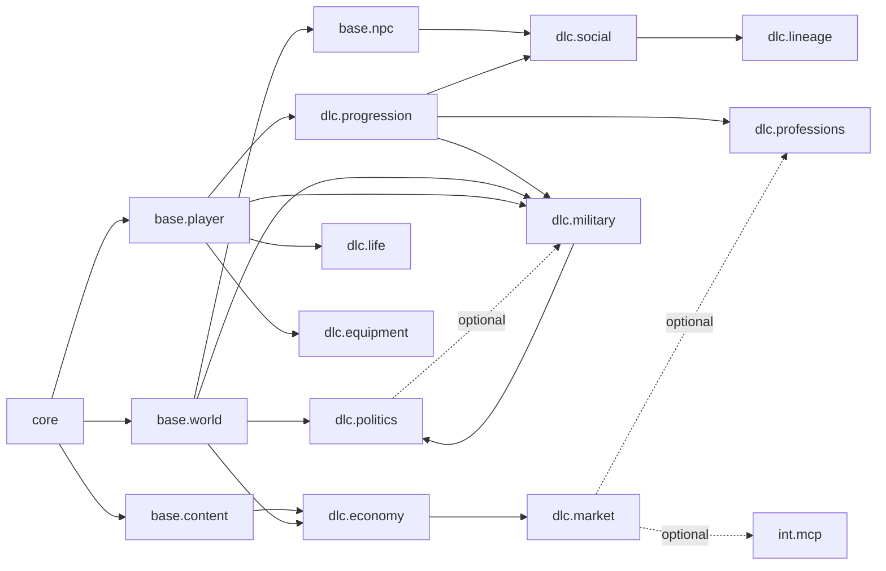

# 08 — Product Composition

**Purpose:** allow several products to share one Core and select different DLCs through a manifest, instead of forking `src/server/main.ts`.

---

## 1. Current composition

`src/server/main.ts` is the entire product definition:

- It imports and constructs nine concrete modules (`main.ts:52-68`).
- It registers all nine unconditionally (`main.ts:60-68`).
- It imports 19 route registrars and registers all of them (`main.ts:20-39, 91-110`).
- It attaches the result to `globalThis` for the legacy gateway (`main.ts:117-125`).
- It starts `tools/sim-web.js`, which serves 49 legacy handlers regardless of which modules exist.

There is **no** module list, feature flag, product file, license check, or runtime selection. **[V]**

**Consequence:** "Product A uses modules 1–5, Product B uses 1,2,6,7" requires editing `main.ts` and rebuilding. That is a code fork, not composition.

---

## 2. Proposed `ProductManifest`

```jsonc
// products/merchant/product.json
{
  "$schema": "../../platform/contracts/product.schema.json",
  "id": "product.merchant",
  "name": "Merchant in a Time of Chaos",
  "version": "1.0.0",
  "coreApi": "^1.0.0",

  "modules": [
    { "id": "base.content", "version": "^1.0.0" },
    { "id": "base.world", "version": "^1.0.0" },
    { "id": "base.player", "version": "^1.0.0" },
    { "id": "base.npc", "version": "^1.0.0" },
    { "id": "dlc.economy", "version": "^1.0.0" },
    { "id": "dlc.market", "version": "^1.0.0" },
    { "id": "dlc.professions", "version": "^1.0.0" },
    { "id": "dlc.progression", "version": "^1.0.0" },
    { "id": "dlc.social", "version": "^1.0.0" },
    { "id": "dlc.lineage", "version": "^1.0.0", "optional": true },
    { "id": "dlc.life", "version": "^1.0.0" }
  ],

  "capabilityBindings": {
    "market.price.quote": "dlc.economy",
    "inventory.stock.issue": "base.player"
  },

  "config": {
    "calendar": { "startingDate": "184-05-02" },
    "economy": { "priceModel": "regional", "crisisMultiplier": 1.0 },
    "market": { "perishables": true, "insurance": true }
  },

  "runtime": {
    "http": { "port": 3300 },
    "database": { "mode": "single-file", "path": "saves/session.db" }
  },

  "ui": {
    "bundle": "web-ts",
    "legacyScripts": true
  },

  "licensing": {
    "mode": "none"
  },

  "failurePolicy": {
    "required": "fail-boot",
    "optional": "disable"
  }
}
```

A product is **data**, not code. Adding a product means adding a JSON file and a list of installed packages, not editing Core.

---

## 3. Example products

### Product A — Merchant campaign

| Element | Selection |
| --- | --- |
| Core | Kernel + data + time + ledger + ids + transport |
| Base | content, world, player, npc |
| DLC | economy, market, professions, progression, social, lineage (optional), life, equipment |
| Integration | none |
| UI | TS slices + legacy shell |
| Runtime | Embedded, single file |
| Value | Trade routes, warehouses, workshops, family dynasty |

### Product B — Warlord campaign

| Element | Selection |
| --- | --- |
| Core | same |
| Base | content, world, player, npc |
| DLC | military, politics, economy, progression, lineage, equipment, social |
| Integration | none |
| UI | TS slices + legacy shell |
| Runtime | Embedded, single file |
| Value | Recruitment, sieges, court politics, succession |

### Product C — Full sandbox / agent mode

| Element | Selection |
| --- | --- |
| Core | same |
| Base | all |
| DLC | all |
| Integration | mcp (isolated), agent-bridge (optional isolated) |
| UI | TS slices + legacy shell + agent dashboard |
| Runtime | Embedded + isolated MCP |
| Value | Full simulation, external agent control |

### Composition matrix

| Module | Merchant | Warlord | Sandbox |
| --- | --- | --- | --- |
| `base.content` | ● | ● | ● |
| `base.world` | ● | ● | ● |
| `base.player` | ● | ● | ● |
| `base.npc` | ● | ● | ● |
| `dlc.economy` | ● | ● | ● |
| `dlc.market` | ● | ○ | ● |
| `dlc.professions` | ● | ○ | ● |
| `dlc.progression` | ● | ● | ● |
| `dlc.social` | ● | ● | ● |
| `dlc.lineage` | ○ | ● | ● |
| `dlc.politics` | ○ | ● | ● |
| `dlc.military` | ○ | ● | ● |
| `dlc.life` | ● | ● | ● |
| `dlc.equipment` | ● | ● | ● |
| `int.mcp` | ○ | ○ | ● |
| `int.agent-bridge` | ○ | ○ | ● |

● = required, ○ = omitted or optional.

---

## 4. Module compatibility rules

The manifest does not need a full SAT solver; it needs declared requirements and a resolver.

| Module | Requires (hard) | Optional |
| --- | --- | --- |
| `dlc.economy` | core, `base.content`, `base.world`, `base.player` | `base.npc` |
| `dlc.market` | `dlc.economy`, `base.world`, `base.player` | `base.npc` |
| `dlc.professions` | `dlc.progression`, `base.world`, `base.player`, `base.content` | `dlc.market` |
| `dlc.progression` | `base.player`, `base.content` | `base.npc`, `dlc.social` |
| `dlc.social` | `base.npc`, `dlc.progression` | `dlc.lineage` |
| `dlc.lineage` | `base.npc`, `dlc.progression`, `dlc.social` | `dlc.politics` |
| `dlc.politics` | `base.world`, `base.npc`, `dlc.progression` | `dlc.military` |
| `dlc.military` | `base.world`, `base.player`, `dlc.progression`, `dlc.equipment` | `dlc.politics`, `dlc.lineage` |
| `dlc.life` | `base.player`, `dlc.progression` | `dlc.social` |
| `dlc.equipment` | `base.player` | `dlc.professions` |
| `int.mcp` | core capabilities | any DLC capability |
| `int.agent-bridge` | `base.npc` | `dlc.social` |



---

## 5. Selection algorithm

At boot, the composition root performs:

1. **Load** `product.json`; validate against the product schema.
2. **Resolve install set:** the manifest's modules plus transitive `requires`.
3. **Check compatibility:** Core `apiVersion`; module version ranges; capability providers; duplicate table claims; duplicate route prefixes.
4. **Topologically sort** by `requires`.
5. **Validate config:** merge Core defaults + product config + module defaults; reject unknown keys in strict mode.
6. **Check entitlements** (if licensing is enabled) — a missing license disables an optional module or fails a required one.
7. **Initialize and start** in order; optional failures are recorded, required failures abort.
8. **Register UI assets** for enabled modules only.
9. **Expose** the resolved composition via `/api/system/modules` for diagnostics.

Errors are aggregated, not first-failure:

```json
{
  "ok": false,
  "errors": [
    { "code": "MISSING_MODULE", "module": "dlc.market", "requires": "dlc.economy" },
    { "code": "VERSION_INCOMPATIBLE", "module": "dlc.military", "requires": "^2.0.0", "available": "1.4.0" },
    { "code": "DUPLICATE_TABLE", "table": "warehouses", "owners": ["dlc.market", "dlc.market.warehouse"] }
  ]
}
```

---

## 6. Product-level configuration

Configuration has three layers:

| Layer | Owner | Example |
| --- | --- | --- |
| Core defaults | Core | calendar, fatigue cap, currency labels |
| Product overrides | Product manifest | starting date, price model, enabled content packs |
| Module defaults | Module manifest | market perishable rates, military round cap |

Merge order: Core → module → product (product wins), with schema validation at each step. Secrets and environment (`SIM_DB_PATH`, `PORT`) stay outside the manifest.

**Do not** put module business tables (price curves, combat tables) in the product manifest. Those belong to the module's config or content pack.

---

## 7. Licensing and entitlements

| Mode | Behaviour | Recommendation |
| --- | --- | --- |
| `none` | No checks | **Default**; matches current single-player product |
| `static` | Signed product file lists entitled module IDs; checked at resolve | Optional; cheap |
| `server` | Online license server | **Not recommended**; adds availability and privacy risk for no current benefit |

Define `licensing.mode` in the schema now so products are forward-compatible, but implement only `none` and optionally `static`.

---

## 8. Runtime selection per product

| Product | HTTP | Isolated processes | Database |
| --- | --- | --- | --- |
| Merchant | 1 process | none | `saves/session.db` |
| Warlord | 1 process | none | `saves/session.db` |
| Sandbox | 1 process + MCP | MCP stdio | `saves/session.db` |

Runtime mode is a product field, but the default must remain "embedded". A product must not be able to silently turn a transactional module into a remote call.

---

## 9. Packaging options

| Option | How | Pros | Cons | Recommendation |
| --- | --- | --- | --- | --- |
| **A. Single package + manifest filter** | One npm package; modules are folders; boot filters by manifest | No build complexity; tree-shaking irrelevant for a server | Disabled code still on disk | **Start here** |
| **B. npm workspaces** | `platform/*`, `modules/*`, `products/*` as workspace packages | Real package boundaries; independent versioning | Install/build complexity; `tsx` resolution; path aliases | After 3 DLCs are stable |
| **C. Dynamic import by manifest** | Read manifest, `import()` module entry points | True install/uninstall without rebuild | Startup cost, error handling, bundling the UI | Only if third-party DLC is a goal |
| **D. Separate deployables** | Each DLC a service | Isolation | Distributed consistency; not justified | Rejected |

**Recommended sequence:** A now → B when packaging a second product → C only if external partners ship DLC.

---

## 10. Feature flags vs DLC

| Use | Mechanism |
| --- | --- |
| A module that is installed but not part of this product | Product manifest (module selection) |
| A behaviour inside an enabled module (e.g. perishables on/off) | Module config |
| An experimental gameplay rule | Config flag, default off, removed after two releases |
| A per-player unlock | Game state, not a module flag |
| A commercial entitlement | License/entitlement, separate from enablement |

Do not use feature flags to emulate modules. A flag keeps the code loaded, the tables present, and the contracts active; a module selection removes all three.

---

## 11. Version matrix

| Product version | Core API | Base modules | DLC ranges | Notes |
| --- | --- | --- | --- | --- |
| 1.x | 1 | ^1.x | ^1.x | Initial manifest era |
| 2.x | 2 | ^2.x | market ^2, lineage ^2, others ^1 | Core API break requires module updates |

Rules:

- A product pins major versions and allows minor/patch upgrades.
- A module declares `apiVersion`; Core supports current + previous major for one release cycle.
- A product cannot include two modules providing the same capability unless `capabilityBindings` selects one.
- Two modules cannot claim the same table.

---

## 12. Product composition verdict

| Question | Answer |
| --- | --- |
| Can multiple products share one Core? | **Yes**, after the manifest exists. The business boundaries already support it. |
| What is missing? | Manifest, resolver, route ownership, capability bindings, enable/disable, per-product config. |
| What is the first product split? | Merchant vs Warlord; they differ by `market/professions` vs `military/politics`. |
| Does this require separate builds? | No. One package with manifest selection is enough for the first two products. |
| Does this require separate databases? | No. One campaign database per product instance. |
| What is the risk? | A manifest that grows into a second configuration language. Keep it declarative, typed, and small. |

**Minimum viable composition:** a `products/<id>/product.json`, a resolver that filters the existing 9 modules + 7 route folders, and a `/api/system/modules` diagnostic endpoint. That alone turns "product" from a code fork into data.
