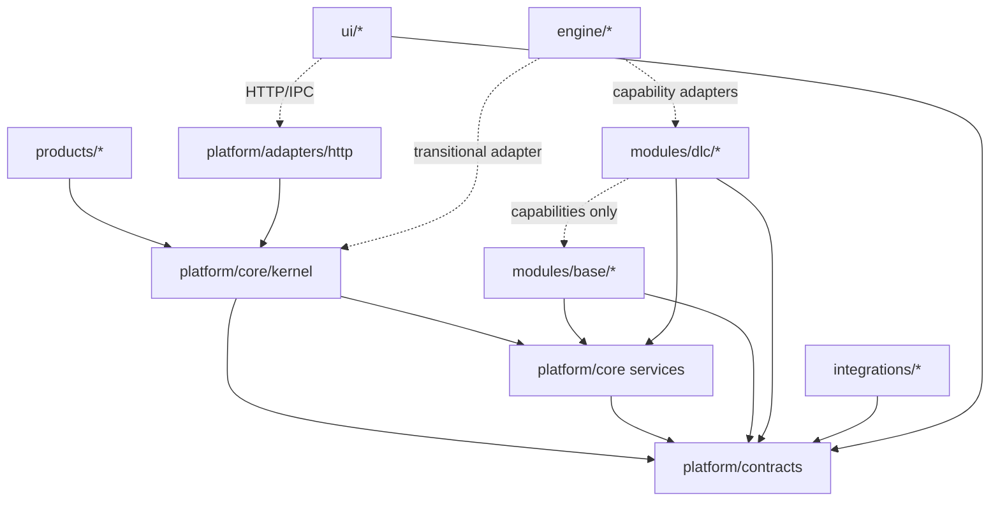

# 09 — Target Architecture

**Purpose:** propose a source layout that fits this repository's runtime (Node + `tsx` + SQLite, one package), not a generic .NET solution template.

---

## 1. Constraints that shape the target

| Constraint | Evidence | Architectural consequence |
| --- | --- | --- |
| One Node process, one SQLite file | `main.ts`, `database.ts` | Keep modules embedded; no service mesh |
| TypeScript executed directly (`tsx`) | `package.json`, bridges | No compile step to enforce package boundaries; enforce with tooling |
| `better-sqlite3` is synchronous | driver | Transaction boundaries are explicit; avoid async fan-out inside a transaction |
| The turn loop is CommonJS | `engine/gameplay-manager.js` | Core must expose a CJS-compatible facade during transition |
| Two browser clients | `public/js`, `src/client` | UI boundaries are separate from server modules |
| 89 migrations, 125 tables | live schema | Ownership is metadata first, physical split later |
| 108 verification suites | `tests/` | Every structural move must keep the gate green |

---

## 2. Target layout

```text
platform/
  contracts/                 # types only; zero runtime imports
    module.ts                # ModuleManifest, ModuleContext, Lifecycle
    capability.ts            # descriptors, broker, Result
    data.ts                  # DbSession, UnitOfWork
    time.ts                  # GameDate, Clock, ActionCost
    ledger.ts                # LedgerEntry, AccountCode
    events.ts                # EventEnvelope, publisher
    transport.ts             # HttpRouter, RouteRegistrar, HttpResult
    config.ts
    errors.ts
  core/
    data/                    # sqlite driver, migrations, ownership registry
    time/                    # calendar, clock, action policy adapter
    ledger/                  # cashflow + double entry + accounts
    ids/                     # id generator + seeded rng
    events/                  # in-process publisher (+ optional outbox)
    kernel/                  # registry, resolver, lifecycle, capabilities
    config/                  # loader + schema validation
    observability/           # logger, invariants, audit hooks
  adapters/
    http/                    # Router implementation, static files, CORS
    mcp/                     # tool adapter over capabilities
    projection/              # markdown projector
    content/                 # master.db importer/build

modules/
  base/
    content/                 # master_* catalog + importer contracts
    world/                   # map, routes, settlements, ecology
    player/                  # player state, wallet, inventory, bag
    npc/                     # npc lifecycle, ledger, journey
  dlc/
    economy/                 # prices, obligations, contracts, loans, intel
    market/                  # stall, warehouse, freight, merchant routes
      warehouse/             # first pilot slice
      stall/
      freight/
      merchant/
    professions/             # gathering, farming, tools, workshops, labor
    progression/             # skills, perks, talents, fame, quests
    social/                  # kizuna, dialogue, banquet
    lineage/                 # family, marriage, succession, wills
    politics/                # factions, offices, diplomacy, unrest
    military/                # expeditions, sieges, battles, duels, conditions
    life/                    # daily life
    equipment/               # loadout

integrations/
  agent-bridge/              # semantic memory (embedded or isolated)
  mcp/                       # stdio server entry (isolated)

ui/
  web-ts/                    # current src/client (core + features)
  web-legacy/                # current public/js, frozen; shrinks over time
  assets/                    # index.html, styles.css, public assets

products/
  merchant/product.json
  warlord/product.json
  sandbox/product.json

tools/                       # migrations, audit, golden, scaffold, content build
tests/                       # verification suites
engine/                      # legacy runtime; shrinks into platform/adapters
```

### Why these are folders, not 30 npm packages

- The server runs from source; package boundaries add build and resolution cost without runtime benefit.
- Typescript path aliases + a dependency scanner give 90% of the enforcement at 5% of the cost.
- Move to npm workspaces only when a second product must be versioned and released independently.

**Rule:** a new project/package needs a *deployment* or *versioning* reason. A new module needs only a *business* reason.

---

## 3. Dependency rule



Allowed:

- `products → core → contracts`
- `modules/* → contracts + core`
- `modules/dlc → capabilities provided by base/other DLC` (declared, not imported)
- `integrations → contracts`
- `ui → contracts + HTTP client`

Forbidden:

- `contracts → anything`
- `core → modules`
- `base → dlc`
- `dlc → dlc` (source import)
- `modules → adapters/http` (except the module's own controller file)
- `ui → modules` (source import)
- `engine → modules` (except a registered adapter)

---

## 4. Module internal layout

Recommended per DLC (do **not** create a project per feature):

```text
modules/dlc/market/
  index.ts                   # manifest export + module class
  market.module.ts           # lifecycle only
  contracts.ts               # capability DTOs + IDs
  capabilities.ts            # provider implementations exposed to broker
  features/
    warehouse/
      warehouse.controller.ts
      warehouse.service.ts
      warehouse.repository.ts
      warehouse.types.ts
    stall/
    freight/
    merchant/
  migrations/
    090-market-warehouse.js
  ui/                        # optional feature slice
  README.md                  # responsibilities, owned tables, capabilities
  tests/                     # or tests/verify-market-*.ts at repo level
```

| File | Responsibility | Must not |
| --- | --- | --- |
| `*.module.ts` | Manifest wiring, register capabilities/routes, lifecycle | Contain business rules or SQL |
| `*.controller.ts` | HTTP input/output mapping | Contain business rules |
| `*.service.ts` | Business rules, transaction orchestration | Import another DLC's service |
| `*.repository.ts` | SQL for owned tables only | Touch foreign tables |
| `contracts.ts` | DTOs + capability descriptors | Import services or DB |
| `migrations/` | Owned schema changes | Touch foreign tables |

For small DLCs (`life`, `equipment`), this compresses to `module.ts`, `service.ts`, `controller.ts`, `contracts.ts` — still four files, no artificial layering.

---

## 5. Mapping current → target

| Current | Target | Action |
| --- | --- | --- |
| `src/core/database.ts` | `platform/core/data/sqlite.ts` | Move; add `DbSession` |
| `src/core/module-registry.ts` | `platform/core/kernel/registry.ts` | Extend with manifest/resolver |
| `src/core/event-bus.ts` | `platform/core/events/bus.ts` | Move; fix delivery |
| `src/core/types.ts` | split: `contracts/module.ts` + base modules | Split by owner |
| `src/server/router.ts` | `platform/adapters/http/router.ts` + `contracts/transport.ts` | Type/implementation split |
| `src/server/main.ts` | `products/*/boot.ts` (generic) | Replace hardcoded registration |
| `src/shared/ledger.ts`, `account-codes.ts` | `platform/core/ledger/` | Move |
| `src/shared/action-time.ts`, `constants.ts`, `game-clock.ts`, `game-date.ts`, `id-generator.ts` | `platform/core/time`, `platform/core/ids`, `platform/core/config` | Move |
| `src/shared/market-quote.ts`, `world-price.ts`, `market-price-book.ts` | `modules/dlc/economy/` | Move |
| `src/shared/character-stats/*` | `modules/dlc/progression/` | Move |
| `src/shared/player-bag.ts`, `inventory-movement.ts` | `modules/base/player/` | Move |
| `src/shared/logistics-risk.ts` | `modules/dlc/market/` | Move |
| `src/shared/prestige.ts`, `victory.ts`, `business-succession.ts`, `legacy-store.ts` | progression / lineage / product | Split |
| `src/shared/settlement-ledger.ts`, `faction-ledger.ts` | world / politics | Move |
| `src/modules/economy/` | `modules/dlc/economy/` | Move |
| `src/modules/market/` | `modules/dlc/market/` | Move + split features |
| `src/modules/professions/` | `modules/dlc/professions/` | Move |
| `src/modules/progression/` | `modules/dlc/progression/` | Move |
| `src/modules/social-kizuna/` | `modules/dlc/social/` | Rename + move |
| `src/modules/lineage-succession/` | `modules/dlc/lineage/` | Move |
| `src/modules/faction-politics/` | `modules/dlc/politics/` | Rename + move |
| `src/modules/military/` | `modules/dlc/military/` | Move |
| `src/modules/ecology-logistics/` | split `base/world` + `dlc/market/logistics` | Split |
| `src/modules/npc-lifecycle/` | `modules/base/npc/` | Move |
| `src/modules/instances/` | `platform/instances/` | Move |
| `src/modules/contextual-actions/` | `ui/web-ts/context-actions` or `platform/readmodels` | Reclassify |
| `src/modules/agent-bridge/` | `integrations/agent-bridge/` | Move |
| `src/mcp/` | `integrations/mcp/` | Move |
| `engine/time-manager.js`, `date-utils.js`, `action-policy.js` | `platform/core/time/` (facade) | Adopt into Core |
| `engine/*-bridge.js` | `engine/adapters/*` or capability registration | Convert incrementally |
| `engine/gameplay-manager.js` | `platform/core/kernel/turn-loop` + module capabilities | Extract loop after Core |
| `public/js/` | `ui/web-legacy/` | Freeze, do not move until replacement |

**Important:** these are target locations, not a big-bang move. Each row is a separate, reversible step after the corresponding contract exists.

---

## 6. What stays together

| Group | Why |
| --- | --- |
| `platform/contracts` | Must stay dependency-free and tiny |
| `platform/core` | One runtime, one DB policy |
| `engine/` bridges | One adapter layer; splitting per bridge creates wrapper hell |
| `ui/web-legacy` | A single script graph with global ordering; it must be replaced, not repackaged |
| `tools/` | Build-time only; not shipped |
| Feature folders inside a DLC | They are cohesive; a project per `warehouse`/`stall` is over-engineering |

---

## 7. Fit with Vertical Slice / Feature-based architecture

The repository already follows a **feature-based vertical slice** inside domains (`features/bespoke-forge`, `features/wage-labor`, `features/workforce`). The target keeps that and adds a second dimension:

- **Vertical slice** = feature folder inside a DLC (`warehouse`, `stall`, `freight`).
- **Module boundary** = DLC package (the commercial/independence unit).
- **Core** = horizontal mechanisms only.

So the answer to "is vertical slice compatible?" is: **yes at the feature level; no as the top-level decomposition**. A vertical slice that spans cash + inventory + market + UI is precisely what prevents ownership. The top level must be the DLC boundary; the inside can be slices.

---

## 8. Conformance checks

Add these to `npm run verify` over time:

| Check | Tool | Fails when |
| --- | --- | --- |
| Dependency direction | custom scanner or dependency-cruiser | forbidden edge (see §3) |
| Table ownership | extend `tools/arch-guard.js` | module writes a foreign table |
| Runtime DDL | arch-guard | `CREATE TABLE` outside migrations |
| Master DB writes | arch-guard | `new Database('master.db')` outside content tools |
| Manifest validity | schema validator | invalid product/module manifest |
| Route ownership | route shadow + manifest | route registered outside its module |
| Capability usage | broker strict mode | undeclared capability call |
| Contract-only imports | TypeScript project references or scanner | contracts import runtime code |

These checks are what turn a folder layout into an architecture.

---

## 9. Non-goals

| Non-goal | Reason |
| --- | --- |
| Microservices | No scaling/tenant need; breaks ACID |
| Separate database per DLC | Same |
| Project per feature | Wrapper hell; no deployment benefit |
| Dependency injection container | Constructor injection + context is sufficient |
| ORM | The SQL layer is deliberate and audited |
| Generic plugin API for third parties | No requirement yet; would freeze contracts prematurely |
| UI framework migration as part of this program | The legacy UI is a separate, larger project |
| Hot reload | `tsx watch` is enough |

---

## 10. Target architecture verdict

The target is a **modular monolith with explicit contracts and enforced ownership**, deployed as one Node process, composed by product manifests, with a thin Core and 10–14 business modules.

It preserves everything that makes the current system work — one SQLite transaction, deterministic time, the ledger, the verification gate — while removing the three things that block composition: hardcoded boot, foreign table writes, and transport-coupled modules.
