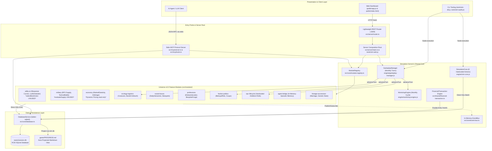
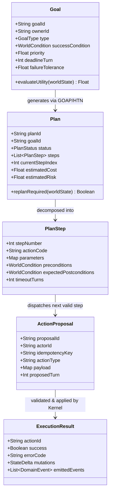
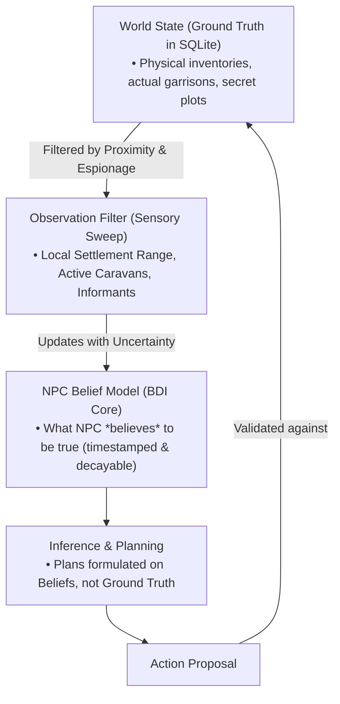
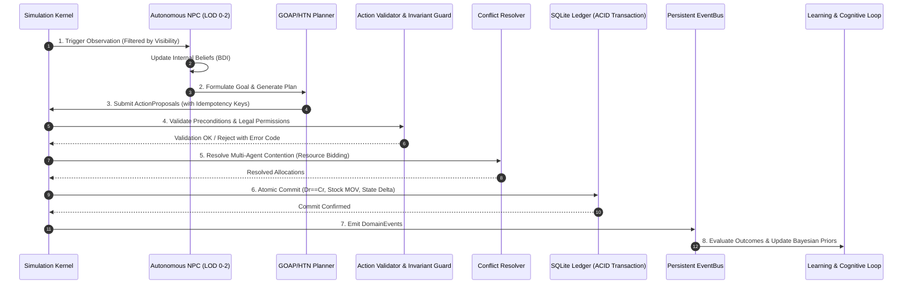
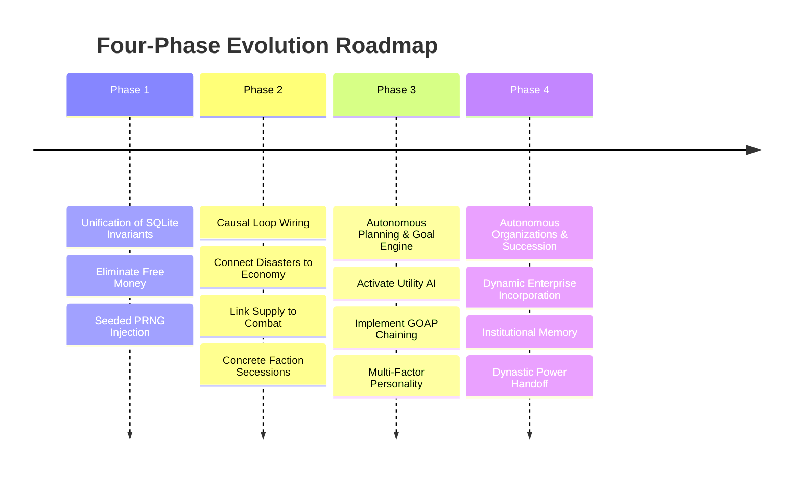

# Deep Architecture Audit & Evolution Plan
## ThreeKingdoms-AgentEngine: Autonomous Simulation & Agentic Core

**Author:** Principal Simulation Architect, AI Agent Engineer & Game Systems Engineer  
**Date:** October 28, 2026  
**Status:** Completed Architectural Assessment & Strategic Roadmap  
**Standards Compliance:** Universe Architecture v4.0, ACID SQLite Ledger, Anti-AI-Slop  

---

## 1. Executive Summary

A comprehensive architectural audit was conducted on the **ThreeKingdoms-AgentEngine** codebase across its TypeScript core (`src/`), legacy engine layer (`engine/`), deterministic verification tooling (`tools/`), test suites (`tests/`), and data definitions (`game/`).

The engine demonstrates exceptional engineering discipline in its **Player-Centric Financial and Inventory Core**:
- Double-entry bookkeeping ($Debit == Credit$) via `account_journal` and `cashflow_ledger` is strictly verified.
- The physical conservation of player inventory via `inventory_items` and `stock_movements` is mathematically sound.
- The SQLite ACID storage model and decoupling between master seed templates (`master_*`) and active session tables (`session_*`) represents a robust foundation.

However, when evaluated against the requirements of an **Autonomous, Living Grand Strategy Simulation**—where NPCs independently formulate goals, synthesize multi-step plans, manage emergent organizations, and adapt within a causally interconnected world—the engine currently exhibits critical structural bottlenecks and simulated facades.

### The 5 Most Critical Architectural Deficiencies

1. **Illusion of Living World Invariants (Asymmetric Simulation Accounting)**:
   While player finances (`PLY-0001`) and player-owned workshops (`BIZ-0001`) adhere strictly to double-entry accounting, all NPC and faction systems violate physical and economic conservation laws. In `src/modules/npc-lifecycle/npc-lifecycle.module.ts` (lines 151–192) and `src/modules/ecology-logistics/ecology-logistics.module.ts` (lines 358–372), NPC personal wealth, troops, and faction treasuries are created out of thin air without counterparties, without inventory deduction, and without ledger logging. The 193/193 passed invariants in `tools/sim-audit.js` only audit player-associated tables, providing a false sense of comprehensive world integrity.

2. **Pseudo-Autonomy & Rigid Hardcoding (Absence of Goal & Planning Freedom)**:
   NPC "autonomy" in `src/modules/npc-lifecycle/npc-lifecycle.module.ts` (lines 139–195) is an illusion driven by a static `switch (prog.life_ambition)` statement executing hardcoded unseeded `Math.random() < 0.5` dice rolls. Career advancements (lines 254–294) are hardcoded if-else statements keyed to specific NPC IDs (`NPC-0001`, `NPC-0003`, `NPC-0007`, `NPC-0008`). The advanced `UtilityAiModule` (`src/modules/utility-ai/utility-ai.module.ts`) exists merely as an isolated library; its core selection method `selectBestAction` (line 99) is **never called anywhere in the active simulation loop**.

3. **Causal Decoupling & Dead Ticks (Superficial Cross-Module Reactivity)**:
   The simulated domains (economy, military, politics, ecology) execute as isolated silos. Ecological disasters (e.g. `GREAT_DROUGHT` in `regional_ecological_crises`) define `agriculture_penalty`, but this field is never read by agricultural yields or market prices. Military supply paths (`SupplyGraphService.hasUnbrokenSupplyPath`) are never checked during combat or garrison depletion; `MilitaryModule.evaluateArmySupply` (line 160) is completely uncalled. Crucially, the EventBus subscriptions for `WORLD_DAY_TICK` and `WORLD_MONTH_TICK` are **dead code** because neither event is ever published by the runtime loop.

4. **Widespread Non-Determinism (Replay Infeasibility)**:
   Although `engine/random.js` implements a robust `SeededRandom` class and passes isolated unit tests (`tests/test-reproducibility.js`), the runtime TypeScript modules in `src/modules/` bypass it completely. Over 40 instances of unseeded `Math.random()` and wall-clock timestamps (`Date.now()`, `process.hrtime.bigint()`) are utilized to generate combat rolls, stat mutations, transaction IDs, and career shifts. Consequently, running a simulation twice with the same seed will rapidly diverge.

5. **Non-Transactional Turn Progression & Process-Level Coupling**:
   The primary simulation advancement loop (`GameplayManager.advanceTurn` in `engine/gameplay-manager.js`, lines 259–450) executes multiple discrete database operations without an encompassing ACID transaction. If an error occurs during living world simulation, previous state mutations (such as date progression and fatigue recovery) are committed, leaving the world state corrupt and unrecoverable. Furthermore, `DatabaseService`, `ModuleRegistry`, and `EventBus` are process-level singletons, making it impossible to run two concurrent simulation campaigns within the same Node.js process.

---

## 2. Current Architecture Reconnaissance

### 2.1. Structural Topology

The system operates as a hybrid architecture bridging CommonJS scripts (`engine/`, `tools/`) and TypeScript Universe Architecture v4.0 modules (`src/`):



### 2.2. Application Bootstrap & Execution Flow

1. **Bootstrap Initialization (`src/server/main.ts`)**:
   - `bootstrapGrandStrategy()` instantiates 9 feature modules and registers them into `ModuleRegistry`.
   - `ModuleRegistry.initAll(dbPath)` executes each module's `init(ctx)` sequentially.
   - Modules obtain the singleton `DatabaseService` and subscribe to `EventBus` topics.
   - Controllers register REST endpoints on `Router`.
   - Global references `__GRAND_STRATEGY_MODULES__` and `__GRAND_STRATEGY_ROUTER__` are bound to `globalThis` to facilitate interop with CommonJS `tools/sim-web.js`.

2. **Simulation Progression Loop (`engine/gameplay-manager.js:advanceTurn`)**:
   - `active_turn` is incremented, and `current_date` advances by 1 calendar month (`advanceCalendarMonth`).
   - Player fatigue is recovered (-35), and morale is adjusted (+10).
   - Workshop enterprises (`businesses`) iterate to calculate gross income, deduct wages, and update safe cash.
   - Living world hooks fire:
     - `gsm.npcLifecycle.simulateAllActiveNpcs(nextTurn, nextDate)`
     - `gsm.factionPolitics.simulatePoliticalCycle(nextTurn, nextDate)`
     - `gsm.ecologyLogistics.simulateEcologyAndLogisticsTurn(nextTurn, nextDate)`
   - Fallback procedural strings are injected if modules return empty results.
   - Turn summary records are written to `turn_log` and `chat_chronicle`.
   - `game/PROGRESS.md` is regex-updated on disk.

3. **Data Mutation Channels**:
   - **Channel A (Player Core - Audited)**: `engine/sim-core.js` and `src/shared/financial-transaction.ts`. Enforces balance checking, inserts into `cashflow_ledger`, `account_journal`, and `stock_movements`.
   - **Channel B (Autonomous Modules - Unaudited)**: Modules directly invoke `this.db.execute(...)` or `runSqlBatch(...)`. They mutate `npc_personal_progression`, `session_factions`, and `trade_caravans` without generating double-entry journal entries.
   - **Channel C (Raw SQL Ad-Hoc)**: `engine/db-adapter.js` runs raw strings by opening and closing `better-sqlite3` connections on every call or shelling out to `sqlite3.exe`.

---

## 3. Evidence-Based Audit Findings

The table below catalogs all identified architectural issues, classified by severity (P0–P3) and supported by explicit codebase references:

| Issue ID | Category | Code Evidence & File Location | Severity | Systemic Consequence | Confidence |
| :--- | :--- | :--- | :--- | :--- | :--- |
| **ISSUE-01** | World Integrity | `src/modules/npc-lifecycle/npc-lifecycle.module.ts#L151-L161`, `L188-L194` | **P0** | Money (`personal_cash`) and troops (`personal_troops`) are generated out of thin air. No double-entry ledger, no conservation of funds, no counterpart deduction. | High |
| **ISSUE-02** | World Integrity | `src/modules/ecology-logistics/ecology-logistics.module.ts#L365-L369` | **P0** | Caravan trading arbitrarily increases `session_factions.treasury_cash` by 135% cargo value without debiting the destination city treasury or adding goods to the market. | High |
| **ISSUE-03** | Reliability | `engine/gameplay-manager.js#L263-L450` | **P0** | `advanceTurn` updates date, player fatigue, businesses, and logs in separate unbundled SQL batches. An unhandled exception midway leaves the session in an inconsistent partial state. | High |
| **ISSUE-04** | Determinism | `src/modules/npc-lifecycle/npc-lifecycle.module.ts#L142`, `L151`, `src/modules/lineage-succession/family-lineage.service.ts#L1081`, `L1169`, `src/shared/financial-transaction.ts#L69` | **P0** | Unseeded `Math.random()` and `Date.now()` are used across all newer modules instead of `SeededRandom`. Deterministic replay of living world turns is mathematically impossible. | High |
| **ISSUE-05** | Autonomy | `src/modules/utility-ai/utility-ai.module.ts#L99-L123` | **P1** | `selectBestAction` is completely uncalled in the codebase. Utility curves exist only as an unintegrated mathematical library; NPCs do not use utility scoring to select actions. | High |
| **ISSUE-06** | Autonomy | `src/modules/npc-lifecycle/npc-lifecycle.module.ts#L139-L195`, `L254-L294` | **P1** | NPCs have zero Goal Freedom or Planning Freedom. Actions are hardcoded in a switch statement with 50/50 dice rolls; career promotions are hardcoded to specific NPC IDs (`NPC-0001` to `NPC-0008`). | High |
| **ISSUE-07** | Causality | `src/modules/ecology-logistics/ecology-logistics.module.ts#L89-L94`, `tools/schema.sql#L388` | **P1** | `agriculture_penalty` and `grain_price_multiplier` in ecological crises are never read by crop production, city stocks, or economic pricing. Disasters are purely decorative. | High |
| **ISSUE-08** | Causality | `src/modules/military/military.module.ts#L160-L179`, `L135-L137` | **P1** | `evaluateArmySupply` is dead code. BFS supply line reachability is never checked during tactical combat or siege assaults. Daily supply check subscription is an empty comment. | High |
| **ISSUE-09** | Causality | `src/modules/faction-politics/faction-politics.module.ts#L340-L364` | **P1** | Governor secession plot inserts an event log and reduces loyalty, but never reassigns `session_settlements.ruler_faction_id`, never spawns a rebel faction, and leaves tax collection unchanged. | High |
| **ISSUE-10** | Memory | `src/modules/agent-bridge/agent-bridge.module.ts#L33`, `L55-L65` | **P1** | Episodic memories are stored in an in-memory array (`memories: NpcMemory[] = []`, max 200). They vanish upon server restart and are never retrieved to influence future NPC decisions. | High |
| **ISSUE-11** | Simulation Kernel | `src/core/event-bus.ts#L9-L54`, `src/core/database.ts#L36-L45` | **P1** | `DatabaseService` and `EventBus` are process-level singletons. Opening a second database closes the first. Multiple concurrent simulation instances in the same process are impossible. | High |
| **ISSUE-12** | Event System | `src/modules/utility-ai/utility-ai.module.ts#L88`, `src/modules/military/military.module.ts#L135` | **P2** | Modules subscribe to `WORLD_DAY_TICK` and `WORLD_MONTH_TICK`, but these events are never published by any runner. Day-level tick progression is entirely non-functional. | High |
| **ISSUE-13** | Performance | `engine/db-adapter.js#L44-L61` | **P2** | `runSqlJson` constructs a new `BetterSqlite3` instance and closes it on every single query, thrashing file handles and OS locks under high query volume. | High |
| **ISSUE-14** | Audit Rigor | `tools/sim-audit.js#L174-L178`, `L208-L211` | **P2** | Auditor returns `passed: true` if `account_journal` or `businesses` tables are missing ("silent pass"). Furthermore, it completely ignores NPC cash, faction treasuries, and settlement garrisons. | High |

---

## 4. NPC Autonomy Audit

### 4.1. Three Freedoms Analysis

To evaluate whether NPCs in ThreeKingdoms-AgentEngine are autonomous agents or merely scripted animatronics, we examine them against the Three Freedoms framework:

```
[Goal Freedom]      --> Can NPC generate, change, or abandon goals?
                           STATUS: ❌ NONE (Hardcoded enum in SQLite baseline)
[Planning Freedom]  --> Can NPC compose multi-step plans to achieve a goal?
                           STATUS: ❌ NONE (Fixed 1-step switch statement)
[Execution Freedom] --> Can NPC execute valid actions governed by world rules?
                           STATUS: ⚠️ SIMULATED (Bypasses rules via direct SQL writes)
```

1. **Goal Freedom (Score: 0/10)**:
   - Goals are represented as a static string column (`npc_personal_progression.life_ambition`) seeded with predefined values (`HEGEMON_UNIFIER`, `RIGHTEOUS_VANGUARD`, `LOYAL_BROTHERHOOD`, `MASTER_ARTISAN`, `DEVOTED_RETAINER`).
   - NPCs cannot assess their changing environment to alter their ambition. If Liu Bei loses all troops and settlements, his ambition remains `HEGEMON_UNIFIER`. If an artisan accumulates vast wealth, they cannot transition to `COMMERCE_TYCOON` unless hardcoded in an explicit if-condition.

2. **Planning Freedom (Score: 0/10)**:
   - There is no planning layer. When `simulateNpcTurn` executes, it evaluates `switch (prog.life_ambition)`.
   - Under `RIGHTEOUS_VANGUARD`, the NPC executes either `MARTIAL_DRILL` or `BANDIT_EXPEDITION` based on `Math.random() < 0.5`.
   - The NPC cannot formulate a plan such as: *"To clear the bandit camp, I need 50 spears. To buy 50 spears, I must secure a loan from the Liang Clan Workshop. Therefore, propose a loan contract first."*

3. **Execution Freedom (Score: 3/10)**:
   - NPCs cannot invoke the engine's validated action pipeline (`SimulationCore.executeAction`).
   - Instead, the module directly injects SQL updates that award arbitrary cash and troops. The actions are executed by simulation decree rather than world kinetics.

### 4.2. Personality Modeling Beyond Hardcoded If/Else

Currently, character personality attributes (`personality`, `motivation` in `npc_state`) are descriptive metadata strings (`PRAGMATIC`, `SECURITY`, `LOYALTY`, `DILIGENT`). They do not parameterize mathematical response curves.

#### Concrete Demonstration: Two Merchants with Identical Competence

Consider two merchant NPCs, **Merchant A (Zhang Shiping - Veteran Risk-Taker)** and **Merchant B (Su Shuang - Conservative Capitalist)**, both possessing identical commercial skill (`COM: 78`, `LOG: 75`, `Cash: 10,000 Qian`).

In the current codebase, both would either execute identical hardcoded logic or require bespoke if/else branches:
```typescript
// CURRENT CODE STYLE (Anti-Pattern: Combinatorial Hardcoding)
if (npc.name === 'Zhang Shiping') {
  // Take high risk trade
} else if (npc.name === 'Su Shuang') {
  // Take low risk trade
}
```

#### The Target Paradigm: Multi-Factor Utility Parameterization

Rather than scripting behavior, personality must be modeled as a vector of continuous weights applied to Utility Response Curves:

$$\text{Utility}(a) = \prod_{i} \left[ C_i(x_i; k_i, x_{0,i}) \right]^{w_i(\mathbf{P})}$$

Where $\mathbf{P}$ represents the NPC's Personality Vector:
- $\rho \in [0, 1]$: Risk Tolerance
- $\alpha \in [0, 1]$: Long-term Ambition vs. Short-term Gain
- $\theta \in [0, 1]$: Social Trust / Kizuna Affinity Bias
- $\tau \in [0, 1]$: Tenacity / Resilience to Sunk Cost
- $\pi \in [0, 1]$: Prestige / Honor Sensitivity

| Trade Opportunity | Market Context | Merchant A ($\rho=0.85, \alpha=0.8, \pi=0.3$) | Merchant B ($\rho=0.20, \alpha=0.3, \pi=0.7$) |
| :--- | :--- | :--- | :--- |
| **High-Risk Grain Arbitrage to Guangzong** | Projected Margin: +85%<br/>Bandit Threat: High (45% ambush risk) | **Utility: 0.82 (SELECTED)**<br/>High $\rho$ suppresses risk penalty curve; high $\alpha$ values massive capital accumulation. | **Utility: 0.18 (REJECTED)**<br/>Low $\rho$ amplifies bandit danger into near-zero utility; prioritizes capital preservation. |
| **Secure Salt Distribution to Luoyang** | Projected Margin: +18%<br/>Imperial Escort: Guaranteed safe | **Utility: 0.35 (REJECTED)**<br/>Opportunity cost too high for aggressive growth ambitions. | **Utility: 0.88 (SELECTED)**<br/>High safety and stable return perfectly aligns with conservative risk profile. |
| **Reaction to Severe Trade Loss (-3,000 Qian)** | Sunk Cost Dilemma | **High Tenacity ($\tau=0.8$):** Leverages credit, hires veteran guards, doubles down on high-margin contraband. | **Low Tenacity ($\tau=0.3$):** Liquidates inventory at a loss, cuts payroll, retreats to local workshop rentals. |

This formulation achieves behavioral divergence naturally through continuous mathematics without a single custom conditional statement.

---

## 5. Planning and Action Model

### 5.1. Evaluation of Planning Methodologies

To deliver an engine capable of unscripted emergent strategy while remaining deterministic and performant, we evaluate five planning paradigms:

| Methodology | Best Suited For | Simulation Engine Fit | Codebase Recommendation |
| :--- | :--- | :--- | :--- |
| **Continuous Utility AI** | Instantaneous priority ranking, need satisfaction, continuous environmental reaction. | **Excellent** (Fast, deterministic, $O(N)$ evaluation). | **Core Primitive Selector**: Use for LOD2 background NPCs and immediate tactical choice. |
| **GOAP (Goal-Oriented Action Planning)** | Chaining atomic primitive actions dynamically to satisfy state preconditions. | **High** ($A^*$ state space search over backward action chaining). | **Strategic Planning Engine**: Mandate for trade, logistics, and military campaign formulation. |
| **HTN (Hierarchical Task Networks)** | Standardized institutional doctrines (e.g. governing a citadel, running a guild). | **Medium-High** (Structured decomposition, low search branching). | **Organizational Routine Engine**: Use for enterprise operations and settlement governance. |
| **Behavior Trees (BT)** | Reactive sequential behaviors with tick interrupts and fallback states. | **Moderate** (Can become unwieldy across complex economic trade-offs). | **Avoid for Macro Strategy**: Reserve only for 1v1 duels or discrete interaction dialogs. |
| **LLM Planning** | Creative diplomatic maneuvers, unexpected narrative schemes, unscripted intrigue. | **Low at runtime; High on demand** (Slow, non-deterministic, costly). | **Selective Advisory Seam**: Trigger only on critical strategic dilemmas (LOD0). |

### 5.2. Minimum Data Architecture for Autonomous Planning

To replace hardcoded actions, the engine must implement a formal five-tier planning contract:



### 5.3. Primitive Action Taxonomy: Merchant Strategy Case Study

An unscripted merchant strategy (e.g. *"Monopolize Iron in Youzhou by cornering the Zhuo Mine, establishing a local weapons forge, and starving out rival blacksmiths"*) must emerge from the composition of atomic primitives:

```
[PRIMITIVE ACTION INVENTORY]
├── Economic Core:
│   ├── ACT_PROCURE_COMMODITY      (Buy raw materials/goods at current market price)
│   ├── ACT_LIQUIDATE_COMMODITY    (Sell inventory at current market price)
│   ├── ACT_DISPATCH_CARAVAN       (Transit cargo from Origin to Destination via route)
│   ├── ACT_OFFER_TRADE_CONTRACT   (Forward contract: fixed price, future delivery)
├── Capital & Enterprise:
│   ├── ACT_INCORPORATE_ENTERPRISE (Register business entity with starting safe cash)
│   ├── ACT_LEASE_FACILITY         (Lease workshop/tavern/forge in settlement)
│   ├── ACT_POST_JOB_VACANCY       (Set wage, recruit specialist/artisan)
│   ├── ACT_TERMINATE_EMPLOYEE     (Dismiss worker, adjust morale)
│   ├── ACT_EXTEND_CREDIT_LINE     (Lend cash at interest rate with collateral)
├── Political & Informational:
│   ├── ACT_SOLICIT_OFFICIAL_PERMIT(Bribe/petition governor for monopoly license)
│   ├── ACT_DISPATCH_RECON_AGENT   (Probe competitor inventory, routes, or bandits)
│   └── ACT_HIRE_ROUTE_ESCORT      (Contract garrison or militia to protect caravan)
```

| Merchant Strategic Maneuver | Engine Implementation via Action Primitives | Status in Current Codebase |
| :--- | :--- | :--- |
| **1. Regional Arbitrage** | `ACT_PROCURE_COMMODITY` (Zhuo) $\rightarrow$ `ACT_DISPATCH_CARAVAN` $\rightarrow$ `ACT_LIQUIDATE_COMMODITY` (Yecheng). | **Partially Implemented**: Procurement exists in `sim-core.js`; caravans exist in `ecology-logistics.module.ts`, but are disconnected from market supply/demand. |
| **2. Vertical Integration** | `ACT_LEASE_FACILITY` (Forge) $\rightarrow$ `ACT_POST_JOB_VACANCY` (Blacksmith) $\rightarrow$ `ACT_PROCURE_COMMODITY` (Iron Ore) $\rightarrow$ `ACT_EXECUTE_RECIPE` (Spears). | **Partially Implemented**: Exists in `enterprise-labor.service.ts` for Player `PLY-0001`, but inaccessible to autonomous NPCs. |
| **3. Predatory Pricing & Monopoly** | `ACT_PROCURE_COMMODITY` (Buy out all local iron) $\rightarrow$ `ACT_SOLICIT_OFFICIAL_PERMIT` (Exclusive smelting) $\rightarrow$ Force competitors into bankruptcy. | **Missing Primitives**: No license bidding primitive; no NPC capital accumulation loop to sustain predatory loss-leaders. |
| **4. Delegated Enterprise Management** | `ACT_INCORPORATE_ENTERPRISE` $\rightarrow$ `ACT_ASSIGN_MANAGER` (Promote Foreman) $\rightarrow$ Allocate monthly budget $\rightarrow$ Autonomous operations. | **Primitive Exists, Engine Lacks Autonomy**: `businesses.manager_npc_id` exists, but managers have no independent action budget. |

---

## 6. Causality and World Consistency

### 6.1. Audit of the Three Causal Chains

#### Chain 1: Economic Collapse
$$\text{Crop Failure} \longrightarrow \text{Supply Deficit} \longrightarrow \text{Price Surge} \longrightarrow \text{Purchasing Collapse} \longrightarrow \text{Business Distress} \longrightarrow \text{Unemployment} \longrightarrow \text{Rebellion}$$

- **Execution Trace in Current Code**:
  - `EcologyLogisticsModule.seedBaselineCrises()` seeds `CRISIS-184-YE` (`GREAT_DROUGHT` in Yecheng, `agriculture_penalty: 0.5`).
  - **BREAKPOINT 1**: In `engine/gameplay-manager.js` and `src/modules/economy/`, crop production formulas never query `regional_ecological_crises`. The agriculture score in `session_settlements` remains unchanged.
  - **BREAKPOINT 2**: Grain price in `sim-core.js` is read from `COMMODITY_PRICE_INDEX` in `engine/rules.js` (static 100 Qian) or supplied by the caller. `MarketElasticity.calculateDynamicPrice` is only invoked as a read-only quote in `economy.controller.ts`.
  - **BREAKPOINT 3**: Businesses in `engine/workshop-engine.js` simulate monthly cycles based purely on available hours and safe cash. They do not purchase food for workers or react to local citizen purchasing power.
- **Verdict**: **COMPLETELY BROKEN AT STEP 1**. The disaster is an isolated record in the database that has zero ripple effect on actual transactions.

#### Chain 2: Military Logistics Breakdown
$$\text{Supply Route Cut} \longrightarrow \text{Depleted Provisions} \longrightarrow \text{Morale Collapse} \longrightarrow \text{Combat Ineffectiveness} \longrightarrow \text{Defeat / Surrender}$$

- **Execution Trace in Current Code**:
  - `MilitaryModule.graph.setEdgeBlocked('LOC-0001', 'LOC-0003', true)` breaks the BFS supply path.
  - `MilitaryModule.evaluateArmySupply(army)` calculates `moraleDelta = -15` if `!isSupplied`.
  - **BREAKPOINT 1**: `evaluateArmySupply` is **never called anywhere in the codebase**. The event listener in `MilitaryModule.init()` (`WORLD_DAY_TICK`) contains only an empty comment (`// Daily check of supply status`).
  - **BREAKPOINT 2**: When `executeTacticalAssault` runs (`src/modules/military/military.module.ts#L185`), combat resolution checks character attributes and dice rolls, completely ignoring whether the army is in supply or starved.
- **Verdict**: **BROKEN AT INTEGRATION SEAM**. The graph algorithm functions mathematically in unit tests, but is completely omitted from the runtime simulation loop.

#### Chain 3: Political Discontent and Secession
$$\text{Unfair Power Allocation} \longrightarrow \text{Resentment} \longrightarrow \text{Loyalty Degradation} \longrightarrow \text{Conspiracy Formation} \longrightarrow \text{Coup / Secession}$$

- **Execution Trace in Current Code**:
  - `FactionPoliticsModule.calculateBetrayalRisk` computes a score based on ambition, loyalty, and appointed governorship (`betrayal_risk >= 0.65`).
  - `FactionPoliticsModule.simulatePoliticalCycle` iterates through disgruntled officers. If the officer is an appointed governor, it logs: `Biến cố Thái thú: [Officer] Cát Cứ Tại [Settlement]!`.
  - **BREAKPOINT 1**: In lines 352–364 of `faction-politics.module.ts`, the database transaction merely inserts an event record into `faction_political_events` and decrements loyalty by 15.
  - **BREAKPOINT 2**: `session_settlements.ruler_faction_id` is **never updated**. The settlement remains owned by the original faction.
  - **BREAKPOINT 3**: In line 410, faction tax collection queries `WHERE s.ruler_faction_id = session_factions.faction_id`. The original ruler continues collecting full taxes and grain from the "seceded" city!
- **Verdict**: **SIMULATION FACADE**. The secession is merely a narrative newspaper headline; the world state remains 100% frozen in its baseline configuration.

### 6.2. Taxonomy of World Invariants

To eliminate state drift and false audit results, all system constraints must be rigorously categorized:

```
WORLD INVARIANTS TAXONOMY
├── Hard Invariants (Zero-Tolerance Invariants - ACID & SQLite Blocked)
│   ├── INV-H1: Conservation of Currency (Sum of all liquid, safe, and faction cash == Initial Float + Minted Value - Sink Value)
│   ├── INV-H2: Conservation of Physical Stock (Quantity >= 0; Balance_After == Prior_Balance + Inflow - Outflow)
│   ├── INV-H3: Double-Entry Balance (Every TXN has debit entries == credit entries exactly)
│   ├── INV-H4: Spatial Exclusivity (An NPC or Army cannot be in two locations at the same turn)
│   └── INV-H5: Title Exclusivity (A settlement cannot have more than one Governor simultaneously)
│
├── Soft Constraints (Permissible Strategic Violations with Dynamic Repercussions)
│   ├── INV-S1: Enterprise Solvency (Safe Cash may drop to 0, triggering insolvency, worker strikes, or bankruptcy)
│   ├── INV-S2: Supply Route Continuity (Armies may operate out of supply, suffering severe daily attrition)
│   ├── INV-S3: Contract Compliance (Debts may default, causing Kizuna collapse, legal bounties, and trade bans)
│   └── INV-S4: Loyalty Allegiance (Loyalty may fall below 20, precipitating defection or mutiny)
│
└── Design Assumptions (Model Hypotheses Requiring Validation)
    ├── INV-D1: Market Equilibrium Convergence (Caravans will eliminate inter-city price arbitrage over 6 turns)
    └── INV-D2: Generational Talent Regression (Genetic child stat variance remains bounded within [-3, +5])
```

---

## 7. Memory, Perception, and Learning

### 7.1. Epistemic Architecture: Ground Truth vs. Agent Beliefs

The simulation currently suffers from **Omniscient State Leakage**: every module queries `session.db` directly, granting NPCs instantaneous global awareness of all settlement inventories, faction treasuries, and secret player stats.

To establish genuine strategic depth, the architecture must separate reality from cognition:



- **World State ($S$)**: The authoritative truth in SQLite.
- **Observation ($O_i$)**: The filtered subset of $S$ accessible to character $i$ based on their physical location, network of contacts, and reconnaissance scouts.
- **Belief ($B_i$)**: The internal model of the world maintained by character $i$. If a rival warlord secretly moved 2,000 troops from Luoyang to Hulao Pass 3 turns ago, $S$ reflects the movement, but the NPC's $B_i$ continues to believe Luoyang has 8,000 troops until fresh observation occurs.
- **Inference ($I_i$)**: Hypotheses generated by the character (e.g. *"Grain prices in Yecheng are spiking; a famine or troop buildup is likely occurring"*).

### 7.2. Multi-Tiered Memory Architecture

The volatile 200-item array in `AgentBridgeModule` must be replaced with a persistent, tiered schema:

```
TIERED AGENT MEMORY
├── 1. Episodic Memory (Autobiographical Log)
│   └── Schema: (memory_id, npc_id, game_date, turn_number, event_type, emotional_valence, raw_narrative, salience_score)
│   └── Storage: SQLite table `npc_episodic_memories` with indices on (npc_id, salience_score)
├── 2. Semantic Memory (Accumulated World Knowledge)
│   └── Schema: (subject_entity, attribute_key, estimated_value, confidence_score, last_observed_turn)
│   └── Example: ("Zhuo Mine", "iron_yield", "High", 0.90, Turn 4)
├── 3. Social Kizuna Memory (Relational Network)
│   └── Schema: (holder_id, target_id, affinity, respect, trust, fear, debts_json, secrets_json)
│   └── Storage: SQLite table `npc_social_mesh` (persisted version of in-memory KizunaModule)
├── 4. Strategic Memory (Action-Outcome Valuation)
│   └── Schema: (strategy_code, context_hash, success_count, fail_count, avg_profit, expected_risk)
│   └── Enables reinforcement learning without expensive neural retraining!
└── 5. Institutional Memory (Organizational Knowledge)
    └── Enterprise procedures, trade route maps, recipe blueprints preserved across leadership succession.
```

### 7.3. Verifiable, Lightweight Learning Mechanisms

True machine learning in a grand strategy engine does not require multi-billion parameter backpropagation. It requires **verifiable Bayesian updates to decision priors**:

1. **Trade Route Risk Estimation**:
   When a merchant dispatches a caravan along Route $R$, they maintain a prior belief of ambush probability $P(\text{Ambush} \mid R)$. Upon completion or looting, the NPC updates $P$ via Laplace smoothing:
   $$P(\text{Ambush} \mid R) = \frac{\text{Ambushes Witnessed} + 1}{\text{Caravans Dispatched} + 2}$$
   If this risk crosses their threshold $\rho$, they dynamically re-route or budget for armed escorts.

2. **Counterparty Trust Calibration**:
   If an NPC extends a loan or signs an alliance contract and the counterparty defaults, the NPC updates `trust` in their social mesh:
   $$\text{Trust}_{t+1} = \text{Trust}_t \times (1 - \text{Severity}) - 20$$
   Future utility evaluations for contracts with that specific counterparty are suppressed.

---

## 8. Performance and Determinism

### 8.1. Elimination of Non-Deterministic Sources

To guarantee that any campaign can be replayed bit-for-bit from its initial seed:

```
CURRENT ARCHITECTURE (NON-DETERMINISTIC)       TARGET ARCHITECTURE (100% DETERMINISTIC)
────────────────────────────────────────       ────────────────────────────────────────
Math.random() in 40+ files              ───►   Injected SeededRandom(seed ^ turn ^ npcId)
Date.now() in transaction IDs           ───►   Deterministic Hash: TXN-{turn}-{seq:04d}
In-Memory Map iteration order           ───►   Sorted Key Traversal (OrderBy EntityId)
better-sqlite3 connection disposal      ───►   Persistent WAL Connection Pool
Uncaught async promises on EventBus     ───►   Synchronous Topological Dispatch Pipeline
```

### 8.2. High-Performance Execution & LOD Optimization

Simulating 1,000 active historical NPCs and 200 enterprises across 20 provinces every month will cause frame drops if every character executes full GOAP planning.

We implement the **4-Tier Level of Detail (LOD) Execution Protocol**:

```
LOD ARCHITECTURAL TAXONOMY
├── LOD 0 (Protagonist & Sworn Circle - Top 10 Characters):
│   └── Frequency: Every Turn / Daily Slice
│   └── Planning: Full GOAP + Utility Curves + LLM Cognitive Reflection (on major dilemmas).
│
├── LOD 1 (Provincial Rulers, Generals, Enterprise Owners - ~100 Characters):
│   └── Frequency: Monthly Strategic Turn
│   └── Planning: GOAP / HTN Action Composition + Seeded Probabilistic Skill Checks.
│
├── LOD 2 (Artisans, Specialists, Retainers, Caravans - ~400 Characters):
│   └── Frequency: Round-Robin Staggered (1/4th processed every 7 days via LodScheduler)
│   └── Planning: Normalized Utility Curves (Instantaneous Best Action Selection).
│
└── LOD 3 (Commoners, Garrison Troops, Peasant Masses - Macro Statistics):
    └── Frequency: Quarterly / Seasonal Pulse
    └── Planning: Aggregate Differential Equations (Euler Integration for Population & Grain).
```

---

## 9. Target Architecture: The Universal Simulation Pipeline

To reconcile autonomous agency with absolute world consistency, we specify the standardized **Eight-Stage Universal Simulation Pipeline**:



### Module Boundary Specifications

```
src/
├── kernel/                            # CORE ENGINE KERNEL (AUTHORITATIVE)
│   ├── simulation-loop.ts             # Deterministic pipeline coordinator (Stage 1-8)
│   ├── transaction-context.ts         # ACID transaction wrapper around better-sqlite3
│   ├── conflict-resolver.ts           # Resolves concurrent claims (e.g. buying last grain bag)
│   └── invariant-guard.ts             # Runtime assertion engine (Hard & Soft Invariants)
│
├── cognition/                         # AUTONOMOUS AGENT LAYER (NON-AUTHORITATIVE)
│   ├── perception/                    # Observation filters & Fog of War
│   ├── planning/                      # GOAP Action Planner & HTN Task Networks
│   ├── utility/                       # Continuous response curves & LodScheduler
│   ├── memory/                        # Tiered episodic & semantic memory storage
│   └── learning/                      # Bayesian belief & prior updater
│
├── domain/                            # SIMULATION DOMAINS (RULES & KINETICS)
│   ├── economy/                       # Market pricing, double-entry ledger, trade routes
│   ├── military/                      # Garrison kinetics, logistics graph, tactical combat
│   ├── politics/                      # Factions, offices, secessions, court intrigue
│   ├── ecology/                       # Disasters, weather, resource nodes, harvest cycles
│   └── organization/                  # Autonomous enterprises, guilds, succession
│
└── infrastructure/                    # PERSISTENCE & PROTOCOLS
    ├── database/                      # Persistent WAL SQLite database adapter
    ├── events/                        # Typed, sequenced Domain Event dispatcher
    └── mcp/                           # Model Context Protocol stdio tool bridge
```

---

## 10. Migration Roadmap

The migration from the current coupled state to the autonomous target architecture is structured across four manageable, backward-compatible phases:



### Phase 1: Hardening the Kernel & Universal Ledger (Estimated Effort: 3 days)
- **Objectives**: Enforce physical and financial conservation across ALL entities (NPCs, factions, caravans). Eliminate unseeded `Math.random()`. Wrap turn progression in atomic transactions.
- **Affected Files**:
  - `tools/schema.sql` (Add faction & NPC accounts to `account_journal`).
  - `engine/gameplay-manager.js` (Wrap `advanceTurn` in an ACID transaction block).
  - `src/modules/npc-lifecycle/npc-lifecycle.module.ts` (Replace thin-air cash/troops with legitimate world transactions).
  - `src/modules/ecology-logistics/ecology-logistics.module.ts` (Deduct caravan sales from city treasuries).
  - Global injection of `SeededRandom` into all `src/modules/`.
- **Exit Criteria**: `tools/sim-audit.js` expanded to audit faction cash and settlement garrisons; 100% of tests in `tests/test-reproducibility.js` pass with multi-turn living world simulation.

### Phase 2: Restoring Causal Integrity & Event Piping (Estimated Effort: 4 days)
- **Objectives**: Wire disconnected domain features into active causal chains. Publish `WORLD_DAY_TICK` and `WORLD_MONTH_TICK`.
- **Affected Files**:
  - `src/modules/ecology-logistics/ecology-logistics.module.ts` & `src/modules/economy/market-elasticity.ts` (Apply disaster penalties to agricultural yield and regional prices).
  - `src/modules/military/military.module.ts` (Invoke `evaluateArmySupply` during army movement and combat calculations).
  - `src/modules/faction-politics/faction-politics.module.ts` (Implement true secession: spawn new faction entity, transfer settlement control, update tax routing).
- **Exit Criteria**: Running a 12-turn campaign with a drought in Yecheng produces measurable grain shortages, price surges, and garrison attrition without script interventions.

### Phase 3: Autonomous Goals & GOAP Planning (Estimated Effort: 5 days)
- **Objectives**: Deprecate hardcoded switch statements. Connect `UtilityAiModule.selectBestAction` to NPC daily decisions. Implement GOAP action chaining for merchants and warlords.
- **Affected Files**:
  - `src/modules/utility-ai/utility-ai.module.ts` (Integrate with NPC decision runner).
  - `src/modules/npc-lifecycle/` (Introduce `Goal` and `Plan` schemas; implement backward-search action chaining).
  - `src/modules/contextual-actions/` (Expose action primitives to both player and autonomous NPCs).
- **Exit Criteria**: Merchant NPC autonomously formulates a multi-hop trade expedition (Buy $\rightarrow$ Escort $\rightarrow$ Sell) to satisfy a capital growth goal without bespoke scripting.

### Phase 4: Autonomous Organizations & Generational Succession (Estimated Effort: 4 days)
- **Objectives**: Decouple enterprises and factions from player-only hardcoding. Allow NPCs to incorporate businesses, delegate management, and execute lineage succession upon death/retirement.
- **Affected Files**:
  - `src/modules/professions/enterprise-labor.service.ts` (Support NPC ownership and autonomous payroll management).
  - `src/modules/lineage-succession/family-lineage.service.ts` (Generalize succession protocol from `PLY-0001` to all historical warlords and enterprise proprietors).
- **Exit Criteria**: When an NPC business owner dies, the enterprise automatically transitions to their designated heir or senior foreman, preserving safe cash, payroll, and warehouse inventory.

---

## 11. Testing and Verification Strategy

### 11.1. Required Verification Scenarios

| Test Scenario Code | Core Mechanism Under Stress | Expected Deterministic Outcome |
| :--- | :--- | :--- |
| `SCN-01-MERCHANT-CORNER` | Merchant buys out local iron supply and opens forge. | Iron price spikes in settlement; local blacksmiths without stock suffer reduced output; merchant secures market share. |
| `SCN-02-INSOLVENT-WORKSHOP` | Workshop safe cash drops below monthly payroll threshold. | Foreman attempts emergency liquidation of finished goods; if insufficient, workers strike and efficiency drops to 20%. |
| `SCN-03-TRADE-AMBUSH-LEARN` | Caravan plundered on mountain pass route. | Merchant updates Bayesian risk prior $P(\text{Ambush})$; subsequent shipments either hire armed escorts or divert to highway route. |
| `SCN-04-SUPPLY-CUT-SIEGE` | Besieging army supply route blocked by enemy cavalry. | Army provisions decline to 0; daily morale drops by 15; assault efficiency collapses; commander forced to lift siege and retreat. |
| `SCN-05-SECESSION-CIVIL-WAR` | Governor betrayal risk crosses 0.70 threshold. | Governor declares independence; settlement changes ruler faction in SQLite; original lord loses tax flow and declares war. |
| `SCN-06-SUCCESSION-ORPHAN` | Proprietor dies with active enterprise and minor heir. | Senior foreman assumes interim trusteeship; enterprise continues production; net dividends placed in trust until heir reaches majority. |
| `SCN-07-CONCURRENT-AUCTION` | 3 NPCs attempt to buy the last 10 units of grain simultaneously. | Conflict resolver awards grain to highest bidder or earliest priority; remaining 2 NPCs receive clean `INSUFFICIENT_STOCK` rejection and re-plan. |
| `SCN-08-IMPOSSIBLE-PLAN` | NPC plans trade expedition requiring capital they do not possess. | Action validator rejects proposal with `INSUFFICIENT_FUNDS`; planner falls back to seeking loan or smaller batch. |
| `SCN-09-FOG-OF-WAR-BLUNDER` | Warlord attacks citadel based on stale intelligence (believing garrison is 500 when reinforced to 2,500). | Warlord launches under-strength assault; suffers catastrophic defeat; verifies that planning is executed against Beliefs, not Ground Truth. |
| `SCN-10-TWIN-CAMPAIGN-REPLAY` | Two identical campaigns executed from Seed 1840201 across 36 turns. | Bit-for-bit identical state across all SQLite tables (`session.db`), cash balances, journal entries, and journey logs. |

### 11.2. Quantitative Audit Metrics

To guard against regressions during migration:
- **Zero-Drift Invariant Pass Rate**: $100\%$ ($0$ allowable discrepancies across currency, inventory, and journals).
- **Action Rejection Rate**: Target $< 5\%$ in steady-state (indicates agents formulate valid, feasible plans).
- **Plan Loop Detection**: 0 recurring circular plans ($A \rightarrow B \rightarrow A$ loops capped by heuristic penalty).
- **LOD Execution Budget**:
  - LOD 0/1 (Monthly Turn): $< 50\text{ms}$ per character.
  - LOD 2 (Weekly Tick): $< 2\text{ms}$ per character.
  - Full World Turn (1,000 NPCs, 20 Settlements): $< 350\text{ms}$ total.

---

## 12. Architectural Answers to Mandatory Questions

### Question 1: NPC Goal Autonomy
> *NPC hiện tại có thể tự hình thành mục tiêu hay chỉ lựa chọn mục tiêu được định nghĩa sẵn?*

**Direct Finding**: NPCs currently **CANNOT** form goals autonomously. They possess static ambition strings assigned in baseline seed data (`HEGEMON_UNIFIER`, `MASTER_ARTISAN`, etc.). In `npc-lifecycle.module.ts`, this ambition only acts as a selector for a fixed switch statement executing 1 or 2 hardcoded actions. There is no runtime evaluation of environmental threats, opportunities, or character motivations to generate, discard, or adjust goals.

### Question 2: Emergent Strategy Formulation
> *NPC có thể tự tạo chiến lược mới từ các hành động cơ bản không? Cần bổ sung gì để đạt được điều đó?*

**Direct Finding**: NPCs currently **CANNOT** synthesize new strategies. To achieve this, the engine requires:
1. Decomposing domain actions into standardized atomic primitives with explicit preconditions and postconditions (see Section 5.3).
2. Implementing a Backward-Chaining $A^*$ search planner (GOAP) that chains primitives from the target world state back to the NPC's current inventory/location.
3. Enabling NPCs to submit `ActionProposal` batches to the central `SimulationKernel` for transactional execution.

### Question 3: World Laws vs. Code Limitations
> *Giới hạn nào là quy luật thế giới, giới hạn nào là hạn chế do code?*

**Direct Finding**:
- **Laws of the World (Legitimate Game Mechanics)**: Physical distance between citadels, terrain marching speeds, commodity price elasticity, stamina/fatigue limits, and the conservation of currency.
- **Code Limitations (Artificial Bottlenecks)**: Restricting enterprise ownership to player `PLY-0001`; hardcoding career shifts to IDs `NPC-0001` through `NPC-0008`; omitting supply checks from combat calculations; and generating NPC money out of thin air because no inter-agent banking API exists.

### Question 4: Autonomy Without LLM Token Proliferation
> *Làm thế nào để NPC tự chủ mà không cần LLM ở mỗi tick?*

**Direct Finding**: Autonomy must be driven by **Deterministic Mathematics**:
- Continuous Utility Response Curves (Sigmoid/Exponential) evaluate candidate priorities in under $0.01\text{ms}$.
- GOAP graph search chains atomic actions deterministically in under $2\text{ms}$.
- **LLM is strictly an LOD0 Advisory Seam**: Activated only when an NPC faces a high-salience dilemma (e.g. Sworn Brother asks to surrender to Cao Cao) to generate dialogue and narrative rationale, which is then mapped back into concrete deterministic action proposals.

### Question 5: Epistemic Asymmetry (Beliefs vs. Ground Truth)
> *Làm thế nào để NPC có kiến thức không đầy đủ và niềm tin sai lệch nhưng thế giới vẫn giữ trạng thái thực tế chính xác?*

**Direct Finding**: By enforcing strict architectural decoupling between **World State ($S$)** and **Belief State ($B_i$)** (Section 7.1). The SQLite database tracks objective truth. NPCs plan exclusively against their local, timestamped `BeliefSet`. A warlord attacks because their belief reports a garrison of 500; the combat engine calculates losses using the real SQLite garrison of 2,500. This creates emergent strategic blunders and fog-of-war deceptions without corrupting database integrity.

### Question 6: True Behavioral Adaptation
> *Làm thế nào để nhân vật học hỏi và thực sự thay đổi hành vi tương lai?*

**Direct Finding**: By implementing **Bayesian Parameter Updates** to action utility functions (Section 7.3). When an action succeeds or fails, the NPC does not merely append a text diary; they update the probability and risk weights stored in their persistent `npc_strategic_memory` record. If a trade route is ambushed, the risk weight $\rho$ increases, directly altering the output of future utility calculations without changing any code.

### Question 7: Autonomous Enterprise Operation
> *Làm thế nào để doanh nghiệp hoặc tổ chức tự vận hành mà không cần người sáng lập trực tiếp điều khiển?*

**Direct Finding**: By elevating organizations to **First-Class Domain Entities** with their own capital accounts, operating charters, and succession rules. An enterprise must hold its own `safe_cash` account in `account_journal`. The appointed manager operates under an institutional charter (e.g. *"Produce bamboo shields while safe cash $> 2,000$; reinvest 50% profits; disburse remainder as dividends"*). If the owner dies, ownership shares transfer via the lineage succession registry without halting daily workshop ticks.

### Question 8: Concurrent Multi-Agent Contention
> *Làm thế nào để xử lý xung đột khi nhiều NPC cùng hành động trên một tài nguyên?*

**Direct Finding**: Through the **Two-Phase Action Pipeline** (Stage 4 & 5):
1. **Propose**: All agents submit proposals during the decision phase without mutating state.
2. **Resolve**: The Kernel detects contention (e.g. Total Grain Requested $> 100$). The `ConflictResolver` applies deterministic arbitration rules:
   - Price Auction (highest willing payer wins), or
   - Initiative / Precedence Roll (based on character `LDR` / `WAR` and seeded RNG), or
   - Pro-Rata Distribution (each receives an equal fraction).
3. **Commit**: Only winning allocations are written to SQLite within the ACID transaction block.

### Question 9: Long-Horizon Simulation Stability
> *Làm thế nào để mô phỏng dài hạn mà không phát sinh vòng lặp sự kiện, trạng thái sai lệch hoặc chi phí tính toán quá lớn?*

**Direct Finding**:
1. **Thermodynamic Negative Feedback**: Ensure every positive loop has a dampener (e.g. grain hoarding increases warehouse storage costs and spoilage rates).
2. **Action Hysteresis**: Apply an inertia bonus ($+0.15$) to current activities in utility calculations to prevent erratic action flickering.
3. **Strict Invariant Bounds**: SQLite `CHECK` constraints actively reject negative numbers or runaway values at the driver level.
4. **4-Tier LOD Staggering**: Cap monthly processing time to $< 350\text{ms}$ by running 80% of characters on lightweight LOD2/3 mathematical formulas.

### Question 10: Explainability & Replay of Anomalous Decisions
> *Làm thế nào để tái lập và giải thích một quyết định bất thường của NPC?*

**Direct Finding**: By capturing a structured **Decision Audit Snapshot**:
Whenever an NPC selects a major action, the engine serializes the top 3 candidate actions, their individual utility curve components ($C_1, C_2, \dots$), the active belief state hash, and the RNG seed into `action_log.payload`. To explain why Lu Bu betrayed Ding Yuan, developers or agents simply inspect the mathematical utility weights:
$$\text{Utility}(\text{Red Hare} + \text{Gold}) = 0.98 \quad \gg \quad \text{Utility}(\text{Loyalty to Ding Yuan}) = 0.21$$

### Question 11: Optimal Synthesis of AI Paradigms
> *Nên dùng Utility AI, GOAP, HTN và LLM ở vị trí nào? Có thành phần nào không cần thiết không?*

**Direct Finding**:
- **Continuous Utility AI**: **Mandatory**. Use for immediate tactical evaluation, need scoring, and LOD2 background agents.
- **GOAP**: **Mandatory**. Use for flexible multi-step economic and military planning where actions must be dynamically combined.
- **HTN**: **Optional / Targeted**. Excellent for institutional organization routines (court sessions, workshop shifts), but can be represented via GOAP sub-plans.
- **LLM**: **Selective Peripheral Seam**. Reserve exclusively for deep diplomatic dialogue, player stratagem interpretation, and major milestone narrative generation. Never invoke LLM for routine simulation ticks.
- **Behavior Trees**: **Unnecessary**. Pure BTs create rigid, brittle transition webs that fight against economic and utility-driven reasoning.

### Question 12: Highest-Value, Lowest-Risk Evolution Path
> *Những thay đổi nào tạo ra giá trị lớn nhất mà ít rủi ro phá vỡ hệ thống hiện tại nhất?*

**Direct Finding**:
1. **Step 1 (Zero-Risk Hardening)**: Replace unseeded `Math.random()` and `Date.now()` with `SeededRandom` and deterministic sequence counters across `src/modules/`. This immediately unlocks true reproducible replays without changing any gameplay logic.
2. **Step 2 (Piping Activation)**: Connect existing orphan systems: publish `WORLD_MONTH_TICK` from `GameplayManager` so existing modules receive time ticks, and read `regional_ecological_crises` inside `market-elasticity.ts`.
3. **Step 3 (Utility AI Activation)**: Wire `UtilityAiModule.selectBestAction` into `NpcLifecycleModule.simulateNpcTurn`, replacing the hardcoded 50/50 switch statement with dynamic utility curve ranking.

---

## 13. Definitive Answers to the Three Core Questions

### A. How free are NPCs in reality?
**Empirical Verdict**: In the current implementation, NPCs have **zero strategic freedom**.
They possess neither Goal Freedom nor Planning Freedom. Their apparent life journeys and milestones are predetermined by hardcoded switch-case branches and unseeded coin-flips (`Math.random() < 0.5`). When they gain money or troops, it is generated out of thin air by arbitrary database updates that bypass the economic laws governing the player.

### B. What constraints are binding their autonomy?
**Empirical Verdict**: Their autonomy is restricted not by intentional simulation design, but by **Architectural Gaps and Code Shortcuts**:
1. **Asymmetric Engineering**: A world-class double-entry accounting and invariant engine was built exclusively for player `PLY-0001`, while NPCs were implemented using disconnected procedural shortcuts.
2. **Unwired Modules**: Deep systems were engineered in isolation (Utility curves, BFS logistics graphs, dynamic price elasticity), but left disconnected from the main monthly loop.
3. **Missing Action Abstraction**: The lack of an atomic Primitive Action contract forced developers to hardcode specific macro behaviors (`MARTIAL_DRILL`, `BANDIT_EXPEDITION`) rather than letting agents chain basic verbs.

### C. What is the minimal viable roadmap to achieve true autonomy while preserving consistency?
**Empirical Verdict**: The minimal viable sequence is a **Four-Stage Structural Migration**:
1. **Stage 1 (Kernel Hardening)**: Universalize double-entry bookkeeping to all entities; wrap turn execution in atomic transactions; inject deterministic `SeededRandom`.
2. **Stage 2 (Causal Reconnection)**: Connect disaster data to markets and supply lines to combat resolution; trigger active secessions.
3. **Stage 3 (Cognitive Planning)**: Activate the existing Utility AI module; introduce atomic action primitives and a GOAP search planner.
4. **Stage 4 (Autonomous Institutions)**: Generalize enterprise management and lineage succession to all NPCs, enabling organizations to outlive their creators.

---

## 14. Prioritized Architectural Recommendations

| Recommendation | Business & Simulation Value | Implementation Complexity | Regression Risk | Dependencies | Priority |
| :--- | :--- | :--- | :--- | :--- | :--- |
| **REC-01: Seeded PRNG & Deterministic Sequence Unification** | Critical (Enables testable replays and multi-seed validation) | Low (1-2 days) | Very Low | None | **P0 (Immediate)** |
| **REC-02: Universal Transaction Ledger (Anti-Thin-Air Money)** | Critical (Ensures total world financial conservation) | Medium (2-3 days) | Low | REC-01 | **P0 (Immediate)** |
| **REC-03: Transactional Simulation Kernel (`advanceTurn` ACID)** | Critical (Prevents session corruption on runtime errors) | Low (1 day) | Very Low | None | **P0 (Immediate)** |
| **REC-04: Causal Pipeline Wiring (Disasters, Supply, Factions)** | High (Transforms decorative data into real consequences) | Medium (3-4 days) | Low | REC-02 | **P1 (Near-Term)** |
| **REC-05: Activation of Continuous Utility AI in NPC Lifecycle** | High (Replaces hardcoded switch with dynamic responses) | Medium (2-3 days) | Medium | REC-01 | **P1 (Near-Term)** |
| **REC-06: Atomic Action Primitives & GOAP Planning Engine** | Transformative (Unlocks genuine unscripted strategies) | High (5-6 days) | Medium | REC-04, REC-05 | **P2 (Strategic)** |
| **REC-07: Persistent Tiered Memory & Bayesian Belief Updates** | High (Enables true learning and fog-of-war blunders) | Medium (3-4 days) | Low | REC-02 | **P2 (Strategic)** |
| **REC-08: Autonomous Organization Charters & Succession** | High (Enables emergent enterprises, guilds, and warlord states) | Medium (3-4 days) | Medium | REC-06 | **P3 (Evolution)** |

---

## 15. Open Questions & Code Verification Limitations

1. **Vite Web Dashboard Integration**: The web frontend (`public/app.js`, `public/js/`) interacts with the server via REST endpoints. Any modification to action proposal schemas must maintain backward-compatible JSON payloads for existing UI widgets.
2. **Historical Master Data Scalability**: The master catalog contains over 150 characters and 20 settlements. Expanding this to the full Three Kingdoms roster (1,000+ officers) will require validating SQLite index performance on `npc_relationship_deltas` and `action_log`.
3. **Multi-Agent Conflict Arbitrage**: In high-density trading hubs (e.g. Luoyang), simultaneous procurement requests from 10+ merchant NPCs will require performance profiling on SQLite write-lock contention under WAL mode.
