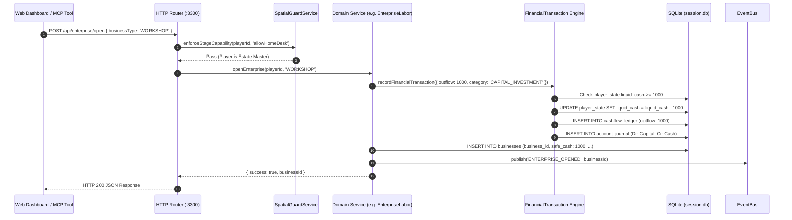
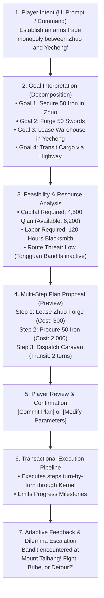

# Comprehensive Audit: Player Character, Agency & World Interaction
## ThreeKingdoms-AgentEngine: Autonomous Simulation & Agentic Core

**Author:** Principal Simulation Architect, AI Agent Engineer & Game Systems Engineer  
**Date:** October 28, 2026  
**Status:** Completed Player Agency & World Interaction Audit  
**Standards Compliance:** Universe Architecture v4.0, ACID SQLite Ledger, Anti-AI-Slop  

---

## 1. Executive Summary

This audit evaluates the **Player Character (PC)**, **Player Agency**, and **PC–World/NPC Interactions** within the **ThreeKingdoms-AgentEngine** codebase.

While our initial audit identified that **NPCs operate as scripted animatronics with zero real autonomy**, this audit investigates the complementary half of the engine:
*How much real agency does the human or AI player possess? Is the player a true embodied entity within the simulation, or merely an administrative puppet master executing privileged scripts? Can the world push back, or is it an obedient sandbox tailored exclusively for the protagonist?*

### Key Findings at a Glance

1. **The Asymmetric Dual-Standard Paradox**:
   The engine enforces two diametrically opposed sets of physics:
   - **For the Player (`PLY-0001`)**: Strict ACID accounting, non-negative cashflow ledger enforcement, physical stock movements, spatial verification guards, fatigue gating, and diminishing returns progression.
   - **For the NPCs (`NPC-xxxx`)**: Lawless procedural decree. Money and troops are created from thin air ([`npc-lifecycle.module.ts#L151-L161`](file:///e:/15.%20Other/Simulation/src/modules/npc-lifecycle/npc-lifecycle.module.ts#L151-L161)), transactions bypass journals, and actions are never validated against physical inventory or spatial location.

2. **Extensive Micro-Agency vs. Constrained Macro-Agency**:
   The player possesses extraordinary granular freedom across crafting ([`bespoke-forge.service.ts`](file:///e:/15.%20Other/Simulation/src/modules/professions/features/bespoke-forge/bespoke-forge.service.ts)), wage labor ([`wage-labor.service.ts`](file:///e:/15.%20Other/Simulation/src/modules/professions/features/wage-labor/wage-labor.service.ts)), interpersonal banquets ([`tavern-banquet.service.ts`](file:///e:/15.%20Other/Simulation/src/modules/social-kizuna/tavern-banquet.service.ts)), marriage, and heir mentorship ([`family-lineage.service.ts`](file:///e:/15.%20Other/Simulation/src/modules/lineage-succession/family-lineage.service.ts)). However, macro-strategic agency is constrained: the player cannot defect to rival factions (hardcoded as ruler of `FAC-LIANG-CLAN`), cannot alter historical settlement sovereignty via political choices, and cannot formulate high-level intent without manually clicking individual atomic buttons.

3. **Absence of Real Risk, Mortality, and Failure (The Invincible Protagonist)**:
   The player character cannot die, go bankrupt, or lose their standing through systemic collapse:
   - Combat defeats clamp health to a minimum of 30 ([`ecology-logistics.module.ts#L312`](file:///e:/15.%20Other/Simulation/src/modules/ecology-logistics/ecology-logistics.module.ts#L312): `MAX(30, health - 20)`).
   - Advancing a monthly turn automatically resets health to 100 ([`gameplay-manager.js#L286`](file:///e:/15.%20Other/Simulation/engine/gameplay-manager.js#L286)).
   - Workshop safe cash depletion triggers an alert, but workers never legally seize assets or liquidate property.
   - Succession to an heir is 100% voluntary; there is no involuntary death from battle wounds, disease, or old age.

4. **Docile NPCs Incapable of Competitive Resistance**:
   NPCs cannot say "No" to a player who possesses sufficient funds. If the player pays the signing bonus, specialists agree immediately without loyalty or affinity checks ([`specialist-workforce.service.ts#L212-L250`](file:///e:/15.%20Other/Simulation/src/modules/professions/features/workforce/specialist-workforce.service.ts#L212-L250)). Rival merchants never outbid the player for iron or grain, never organize boycotts, and never poach player employees.

5. **Purely Reactive, Player-Driven World Clock**:
   The world does not progress independently. If the player leaves the game running without calling `/api/campaign/advance-turn`, the Three Kingdoms era remains indefinitely frozen in Month 2, 184 AD. No rival lord marches, no market price shifts, and no child is born unless the player explicitly triggers the monthly advance turn.

---

## 2. Player Character Model Audit

### 2.1. Identity, State Representation & Hardcoding

In `tools/schema.sql` (lines 19–43), the player state is segregated into a dedicated table:
```sql
CREATE TABLE IF NOT EXISTS player_state (
    player_id TEXT PRIMARY KEY,
    name TEXT NOT NULL,
    style_name TEXT,
    age INTEGER NOT NULL,
    current_location TEXT NOT NULL DEFAULT 'LOC-0001',
    permanent_base TEXT NOT NULL DEFAULT 'LOC-0001',
    int_attr INTEGER NOT NULL DEFAULT 50,
    pol_attr INTEGER NOT NULL DEFAULT 50,
    war_attr INTEGER NOT NULL DEFAULT 50,
    ldr_attr INTEGER NOT NULL DEFAULT 50,
    dip_attr INTEGER NOT NULL DEFAULT 50,
    com_attr INTEGER NOT NULL DEFAULT 50,
    log_attr INTEGER NOT NULL DEFAULT 50,
    cra_attr INTEGER NOT NULL DEFAULT 50,
    liquid_cash INTEGER NOT NULL DEFAULT 15000 CHECK (liquid_cash >= 0),
    safe_cash INTEGER NOT NULL DEFAULT 0 CHECK (safe_cash >= 0),
    strategic_grain REAL NOT NULL DEFAULT 0.0 CHECK (strategic_grain >= 0),
    fixed_capital INTEGER NOT NULL DEFAULT 0 CHECK (fixed_capital >= 0),
    special_licenses TEXT DEFAULT '[]',
    health INTEGER NOT NULL DEFAULT 100 CHECK (health >= 0 AND health <= 100),
    fatigue INTEGER NOT NULL DEFAULT 0 CHECK (fatigue >= 0 AND fatigue <= 100),
    morale INTEGER NOT NULL DEFAULT 100 CHECK (morale >= 0 AND morale <= 100)
);
```

#### Systematic Hardcoding of `'PLY-0001'`
Across the TypeScript modules and CLI scripts, the string `'PLY-0001'` occurs **185 times**:
- In `src/shared/financial-transaction.ts#L43`: Cash deduction queries are hardcoded to `WHERE player_id = 'PLY-0001'`.
- In `src/modules/lineage-succession/family-lineage.service.ts#L328`: Marriages default to `husband_id TEXT NOT NULL DEFAULT 'PLY-0001'`.
- In `src/modules/faction-politics/faction-politics.module.ts#L67`, `L105`: The player is permanently hardcoded as the ruler of `FAC-LIANG-CLAN`.
- In `src/modules/professions/features/workforce/specialist-workforce.service.ts#L191`: Enterprise queries default to `owner_character_id = 'PLY-0001'`.

**Architectural Implication**: The engine does not treat the player as an arbitrary instance of a generic `Character` entity. The player is a hardcoded architectural singleton. Supporting multi-player campaigns, hot-swapping characters, or playing as Cao Cao or Liu Bei would require refactoring 185 separate query sites.

### 2.2. Command Dispatch & Action Resolution Pipeline

When a human player or AI Agent issues a command, the execution traces through the following sequence:



**Key Strengths of this Pipeline**:
- Full ACID atomicity: If the player lacks cash, SQLite throws an error and no partial records are written.
- Complete double-entry verification: $Debit == Credit$ parity is maintained for every player coin spent.
- Spatial verification: Physical actions fail if the player is in the wrong sub-location.

**Critical Weakness of this Pipeline**:
- **NPCs Cannot Use It**: There is no path for an NPC to invoke this pipeline. If an NPC wants to open an enterprise, hire a worker, or forge a blade, no service method supports it without assuming `PLY-0001`.

---

## 3. Player Agency Matrix Across Five Domains

To determine what the player can actually execute versus what is merely descriptive flavor, we assess the five operational domains:

```
PLAYER AGENCY EVALUATION
├── 1. Personal Domain      ───► [HIGH FREEDOM]    (Rich travel, crafting, social & lineage)
├── 2. Economic Domain      ───► [MODERATE-HIGH]   (4 enterprise types, loans, caravans, hiring)
├── 3. Military Domain      ───► [MODERATE]        (Garrison reinforcement, duels, siege assaults)
├── 4. Political Domain     ───► [LOW FREEDOM]     (Fixed faction ruler; secessions do not branch)
└── 5. Unscripted Agency    ───► [MINIMAL]         (No composite planning; discrete atomic clicks)
```

| Domain | Action / Capability | Technical Implementation | True Reality vs. Facade | Status |
| :--- | :--- | :--- | :--- | :--- |
| **Personal** | Spatial Movement between Citadels | `travel-transit.service.ts#L414` (March with terrain days, grain cost, random encounter checks) | **Reality**: Authentic simulation of marching speed, food burn, and combat ambushes. | **Full** |
| **Personal** | Skill & Attribute Growth | `attribute-progression.service.ts` (8 attributes, diminishing returns formula) | **Reality**: EXP awarded across labor, combat, trade, and social activities. | **Full** |
| **Personal** | Interpersonal Relationships | `daily-interaction.engine.ts` (5 Fog tiers, D20 rolls, 6 interaction types) | **Reality**: High-quality social mechanics with mood and hobby affinities. | **Full** |
| **Personal** | Marriage & Dynastic Lineage | `family-lineage.service.ts` (Dowry gifting, cohabitation, gestation, genetic stats) | **Reality**: Comprehensive life-sim mechanics with ancestral archive. | **Full** |
| **Economic** | Commodity Trading & Arbitrage | `sim-core.js#L89` (`TRADE_BUY`, `TRADE_SELL`) & `caravan-logistics.service.ts` | **Mixed**: Double-entry ledger verified, but buy prices are static, not dynamic. | **Partial** |
| **Economic** | Free Enterprise Management | `enterprise-labor.service.ts` (Workshop, Tavern, Apothecary, Blacksmith) | **Reality**: Full capital investment, monthly capacity, safe cash, and profits. | **Full** |
| **Economic** | Workforce Recruitment | `specialist-workforce.service.ts` (Hire 20 specialists, contracts, signing bonus) | **Reality**: Real efficiency multipliers (+15% to +25%) and monthly wage burn. | **Full** |
| **Economic** | Banking & Credit Lines | `economy.controller.ts#L352` (Request loans, interest accrual, debt repayment) | **Reality**: Functional credit mechanics with double-entry journal records. | **Full** |
| **Military** | Citadel Garrison Reinforcement | `military.controller.ts#L220` (Pay cash to reinforce troops in settlements) | **Reality**: Increases `session_settlements.garrison_troops` with double-entry. | **Full** |
| **Military** | Tactical 1v1 Duels | `single-combat-duel.service.ts` (Attack, Defend, Focus, Special Strike, Spirit bar) | **Reality**: Multi-round tactical duels with weapon damage and combat log. | **Full** |
| **Military** | Citadel Siege Assault | `military.module.ts#L185` (`executeTacticalAssault` against bandit camps & Guangzong) | **Reality**: Wall defense degradation, casualties, and war spoils. | **Full** |
| **Military** | Autonomous Military Campaign | Marching armies on map, besieging rival cities at will | **Facade**: Player can only assault pre-designated bandit strongholds and Guangzong. | **Missing** |
| **Political** | Appoint Governors & Invest Titles | `faction-politics.module.ts#L450`, `L510` | **Mixed**: Assigns officers and updates titles, but has zero tax-routing effect. | **Partial** |
| **Political** | Defect to Another Warlord | Renounce Liang clan, swear fealty to Cao Cao or Sun Jian | **Impossible**: Player is permanently locked as ruler of `FAC-LIANG-CLAN`. | **Zero** |
| **Political** | Form Bilateral Treaties | Propose non-aggression pact, military alliance, or partition | **Facade**: Historical event script only; no dynamic diplomatic negotiation. | **Zero** |
| **Initiative** | Build Underground Spy Network | Plant moles in rival cities, intercept correspondence | **Impossible**: No espionage primitives exist in the engine. | **Zero** |

---

## 4. Character Progression and Build Diversity

### 4.1. Archetypes and Starting Conditions

The engine provides 4 starting player archetypes in `master_player_archetypes`:
1. **`ARCH-COMMONER-YOUTH` (Lương Diễn / Liang Yan - Default)**:
   - Initial Cash: 100 Qian. Fixed Capital: 0. Grain: 1.0 Dan.
   - Starting status: Pauper (Stage 1). Starts with no enterprise and must perform daily wage labor ([`wage-labor.service.ts`](file:///e:/15.%20Other/Simulation/src/modules/professions/features/wage-labor/wage-labor.service.ts)).
2. **`ARCH-SCHOLAR-ARTISAN` (Sĩ Tộc Thương Khách)**:
   - Initial Cash: 15,000 Qian. Fixed Capital: 18,000 Qian. Grain: 5.0 Dan.
   - Starts with `BIZ-0001` (Liang Clan Workshop) and 2 retainers (Chen Bao, Zhao An).
3. **`ARCH-FRONTIER-OFFICER` (Hạ Hầu Thắng - Military Commander)**:
   - Initial Cash: 8,000 Qian. High WAR (78), LDR (75).
4. **`ARCH-SILK-CARAVAN` (Chân Hạo - Commercial Magnate)**:
   - Initial Cash: 25,000 Qian. High COM (82), LOG (80).

### 4.2. Progression Mechanics & Pacing

Player progression operates across two coupled ladders:

#### 1. Eight Core Attributes Ladder
$$\text{EXP Required for }+1\text{ Stat} = \begin{cases} 100\text{ EXP} & \text{if Stat} \le 90 \\ 150\text{ EXP} & \text{if } 91 \le \text{Stat} \le 99 \\ 250\text{ EXP} & \text{if Stat} \ge 100 \text{ (Soft Cap: 120)} \end{cases}$$

- Attributes increase through direct practice:
  - Working as a Tavern Cook awards `cra_exp: 15`.
  - Winning a duel awards `war_exp: 25`.
  - Successfully resolving a trade caravan awards `ldr_exp: 20` and `com_exp: 20`.
  - Rest with spouse awards fatigue recovery.

#### 2. Four-Tier Ambition Gating ([`spatial-guard.service.ts`](file:///e:/15.%20Other/Simulation/src/modules/progression/spatial-guard.service.ts))
The engine implements strict feature unlocking based on societal standing:
- **Stage 1: Pauper (Bố Y Tay Trắng)**: Can only perform local wage shifts and small-scale procurement.
- **Stage 2: Estate Master (Tiểu Chủ Trang Viên)**: Unlocks Residence, marriage proposals, childbirth, and workshop ownership.
- **Stage 3: Magnate Commander (Đại Thương Gia / Hào Kiệt)**: Unlocks remote courier letters and interstate trade caravans.
- **Stage 4: Hegemon Warlord (Chư Hầu / Hùng Chủ)**: Unlocks the Grand Command War Room, citadel garrison deployments, and macro-strategy.

### 4.3. The "Omni-Protagonist" Power Creep Risk

A critical game design vulnerability exists in the progression formula: **Zero Mutual Exclusivity**:
- There are no opportunity costs between physical, intellectual, and commercial growth.
- An ambitious player can spend 12 months working in the forge to reach `CRA 90`, spend 12 months dueling to reach `WAR 95`, and spend 12 months running caravans to reach `COM 90`.
- Within 5 simulated years, the protagonist becomes an invincible "Omni-Hero" who outperforms Lu Bu in combat, Zhuge Liang in tactics, and Zhang Shiping in commerce.
- **Recommended Remedy**: Introduce attribute decay for unpracticed skills, or enforce a hard talent point budget that requires specializing into distinct character archetypes.

---

## 5. Player Intent, Strategy and Planning Flow

### 5.1. Current State: Discrete UI Commands

Currently, the player does **not** formulate strategic intentions. The player merely clicks discrete operational buttons exposed by REST endpoints:
- Click: `/api/professions/gather`
- Click: `/api/enterprise/work`
- Click: `/api/caravans/dispatch`

If an AI Agent interacts with the game via MCP, it must issue low-level individual calls:
`sim_query_player` $\rightarrow$ `sim_calculate_price` $\rightarrow$ `sim_check_supply_line`.
There is no endpoint where an Agent or Player can say:
> *"Expand our weapon distribution into Yecheng by securing an iron supply in Zhuo, transporting 50 swords to Yecheng, and hiring an accountant to run a local warehouse."*

### 5.2. Proposed Architecture: Seven-Stage Intent Realization Engine

To enable unscripted sandbox play where the player defines open-ended strategic goals, the engine must implement a **Hierarchical Intent Translator**:



#### Allocation of AI Methodologies across the Pipeline:
- **Step 1 & 2 (Intent & Decomposition)**: **LLM / Semantic Parser**. Interprets freeform text into structured GOAP goal conditions.
- **Step 3 & 4 (Feasibility & Step Generation)**: **Deterministic GOAP Planner ($A^*$ Search)**. Verifies preconditions, calculates exact costs, and maps optimal routes.
- **Step 5 & 6 (Validation & Execution)**: **Simulation Kernel & Invariant Guard**. Executes atomic steps within ACID transactions without LLM intervention.
- **Step 7 (Dilemma Escalation)**: **Utility Curve Evaluator + Optional LLM Dialogue**. Evaluates whether the event requires player intervention.

---

## 6. World Impact and Historical Divergence

### 6.1. Audit of PC Impact on the World State

Does the player actually change the world, or do actions merely alter the player's personal sheet?

| Dimension | Player Action | Documented World State Impact in Code | Broken Causal Links |
| :--- | :--- | :--- | :--- |
| **Market Stocks & Prices** | Player buys 50 units of grain in Zhuo County. | Deducts cash; increments player inventory; decrements `inventory_items` record for Zhuo Workshop. | **Broken**: Local retail market supply in `session_settlements` is NOT decremented; regional grain prices in subsequent turns do NOT increase! |
| **Workforce Pool** | Player hires specialist Lý Thiết Chùy. | Sets `npc_state.assigned_business_id = 'BIZ-0001'`; marks `isHired = true`. | **Intact**: Specialist is successfully removed from the hireable candidate pool across all settlements. |
| **Citadel Defense** | Player reinforces Zhuo County garrison (+25 troops, 200 Qian). | `session_settlements.garrison_troops` increases from 1,525 to 1,550 troops. | **Intact**: Verified in `tests/verify-rotk-grand-loop.ts`. |
| **Territorial Sovereignty** | Player assaults and defeats Guangzong Yellow Turban stronghold. | Stronghold defense reduced from 55 to 45; garrison reduced from 6,375 to 4,781. | **Broken**: Even if garrison reaches 0, the city does NOT change faction control to the player or imperial forces! |
| **Historical Events** | Player chooses alternate option in Peach Garden incident. | Inserts record into `session_events`; awards reputation; logs chat chronicle. | **Broken**: Liu Bei, Guan Yu, and Zhang Fei still form their sworn brotherhood and follow their historical path; the world does not branch. |

### 6.2. Can the World Diverge From Canon History?

**Direct Audit Finding**: The engine currently **FORCES HISTORICAL CANON**.
- In `engine/event-manager.js#L78-L83`: Historical events are queried strictly by `WHERE historical_year <= currentYear`.
- The events table in `schema-master.sql` contains pre-scripted historical milestones spanning from the Yellow Turban Rebellion (184 AD), the Coalition against Dong Zhuo (190 AD), the Battle of Guandu (200 AD), to the Battle of Red Cliffs (208 AD).
- If the player executes an alternate action (e.g. refusing to support the militia or funding the Yellow Turbans):
  - The engine logs the choice in `session_events.player_choice`.
  - **Zero Geopolitical Consequences Follow**: Zhang Jue still dies in 184 AD, Dong Zhuo still burns Luoyang in 190 AD, and Cao Cao still unifies the North.
- **Root Cause**: The political timeline is an uncoupled linear sequence of database rows rather than an emergent simulation driven by faction strength, armies, and resources.

---

## 7. NPC Autonomy Against the Player

A hallmark of a true simulation is that **NPCs are not the player's obedient toys**. We audited the resistance and independence of NPCs:

### 7.1. Can NPCs Refuse Player Requests?

1. **Employment Contracts**: **NO REFUSAL**.
   In [`specialist-workforce.service.ts#L212-L246`](file:///e:/15.%20Other/Simulation/src/modules/professions/features/workforce/specialist-workforce.service.ts#L212-L246), `hireSpecialist` only checks if the specialist exists, if the enterprise exists, and if the specialist is currently unemployed. If the player pays the cash, the specialist is immediately bound to the contract. There is no check of ideological alignment, loyalty, or wage negotiation.
2. **Social Interactions**: **PARTIAL REFUSAL**.
   In [`daily-interaction.engine.ts#L697-L730`](file:///e:/15.%20Other/Simulation/src/modules/social-kizuna/daily-interaction.engine.ts#L697-L730), social interactions execute a D20 check. If the player rolls a `CRITICAL_FAILURE`, the NPC becomes `ANNOYED` and sentiment drops by 15. However, the NPC cannot terminate contact or refuse subsequent interaction requests.
3. **Marriage Proposals**: **THRESHOLD LOCKED**.
   In [`family-lineage.service.ts#L880-L910`](file:///e:/15.%20Other/Simulation/src/modules/lineage-succession/family-lineage.service.ts#L880-L910), marriage requires `Affinity >= 80` and customary dowry. Once these hard thresholds are met, proposal acceptance is 100% deterministic; the NPC has no individual agency to decline.

### 7.2. Can NPCs Compete with or Eclipse the Player?

- **Commercial Rivalry**: **NON-EXISTENT**. Rival merchants (e.g. Su Shuang, Zhang Shiping) never establish competing workshops, never undercut player prices, and never bid up raw materials.
- **Territorial Aggression Against Player**: **NON-EXISTENT**. No enemy army ever marches on the player's residence or besieges the player's workshop.
- **Organic Growth**: **SIMULATED ONLY**. NPCs increment personal stats via `simulateNpcTurn`, but this growth is purely mathematical vanity; it never translates into rival enterprises or independent political factions on the map.

---

## 8. Simulation Paradigms: Player-Centric vs. World-Centric

| Architectural Model | Definition & Mechanics | Engine Presence | Audit Evaluation |
| :--- | :--- | :--- | :--- |
| **Model 1: Player-Centric** | The world is a static stage; events, economic transactions, and combat only occur when the player initiates them. | **Dominant (85%)** | High risk of immersion collapse. When the player is inactive, the entire continent of China freezes in place. |
| **Model 2: World-Centric** | The world runs autonomous macro-simulations across all 20 citadels regardless of player presence. | **Orphaned (10%)** | Systems like `simulatePoliticalCycle` and `simulateEcologyAndLogisticsTurn` exist, but their outputs are decorative logs rather than physical changes. |
| **Model 3: Hybrid Dynamic LOD** | Macro-kinetics run continent-wide at low resolution; micro-kinetics blossom at high resolution around player location. | **Target (5% now)** | **Recommended Architecture**: Combine `LodScheduler` with spatial proximity grids to run 1,000 NPCs efficiently without freezing background history. |

---

## 9. Failure, Mortality, and Succession Audit

### 9.1. Is Real Failure Possible?

We tested the four pillars of simulation failure:

1. **Physical Death / Mortality**:
   - In combat: Player health is explicitly protected by `MAX(30, health - 20)`. The player cannot die in battle.
   - Turn transition: `gameplay-manager.js#L286` unconditionally executes `SET health = 100`.
   - Aging: In `player_state`, `age` increments each year, but there are no aging debuffs, no senescence curves, and no maximum lifespan checks. The protagonist is immortal.
2. **Financial Bankruptcy**:
   - If player liquid cash drops to 0, operations freeze (`INSUFFICIENT_FUNDS`), but creditors never seize fixed assets, never foreclose on workshops, and never throw the debtor into prison.
3. **Political Deposition / Exile**:
   - In `faction-politics.module.ts`, player rank is `RULER` of `FAC-LIANG-CLAN` with `betrayal_risk = 0.0`. The player cannot be overthrown, betrayed by retainers, or stripped of title.
4. **Military Annihilation**:
   - Besieging Guangzong can fail, but failure only deducts 20 health and 40 fatigue. The player's base in Zhuo County is never assaulted or sacked.

### 9.2. Generational Succession Protocol

The engine's crowning achievement in longevity is the **Dynastic Lineage Succession Protocol** in [`family-lineage.service.ts#L1640-L1770`](file:///e:/15.%20Other/Simulation/src/modules/lineage-succession/family-lineage.service.ts#L1640-L1770):
- **Mechanism**: When the player decides to retire, they designate an adult heir from `family_children`.
- **Identity Transfer**: The engine preserves `player_id = 'PLY-0001'` to maintain zero foreign key breakage across `cashflow_ledger`, `businesses`, and `character_equipment`, but updates `name`, `style_name`, `age`, and inherited attributes.
- **Predecessor Archival**: The retiring character is archived into `family_ancestors_archive` with reign dates, accumulated net worth, and posthumous titles (e.g. *"Lương Thị Khởi Nghiệp Thái Tổ"*).
- **Assessment**: This is a brilliant, zero-drift technical design. However, it is currently **100% voluntary**. To deliver authentic drama, succession must also trigger involuntarily upon battle death, assassination, or catastrophic illness.

---

## 10. Information Architecture, UI & Control

### 10.1. Command Taxonomy

The engine communicates with players and agents across six discrete interaction modalities:

```
COMMAND & INTERACTION TAXONOMY
├── 1. Query           ───► GET /api/progression/status, /api/garrisons, /api/economy/arbitrage
├── 2. Preview         ───► GET /api/travel/plan (Calculates days, grain, terrain hazards before commit)
├── 3. Command         ───► POST /api/economy/buy, /api/professions/forge/bespoke
├── 4. Delegation      ───► POST /api/workforce/hire (Assigns manager to automate monthly workshop)
├── 5. Progression     ───► POST /api/campaign/advance-turn (Advances calendar month)
└── 6. Audit & Inspect ───► tools/sim-audit.js (Independent mathematical reconciliation)
```

### 10.2. UI Business Logic Leakage

A critical architectural virtue of this repository is that **the UI contains zero business logic**:
- `public/app.js` and `public/js/*.js` are purely visual rendering shells.
- All attribute math, DC checks, double-entry ledgers, and database constraints reside entirely within backend domain services (`src/modules/`) and SQLite tables.
- This ensures that an AI Agent communicating via stdio MCP tools (`src/mcp/server.ts`) is subjected to the exact same physical rules, validation gates, and financial ledgers as a human playing on the web dashboard.

---

## 11. Player Experience Test Scenarios

To verify player freedom empirically, we specify six end-to-end scenario test suites:

### Scenario A: The Pure Commoner Merchant (No Swords, Pure Silk)
- **Premise**: Player selects `ARCH-COMMONER-YOUTH`, vows never to recruit troops or engage in duels, and focuses entirely on commerce.
- **Validation Path**:
  1. Perform wage labor shifts at Zhuo Tavern (`JOB_TAVERN_STAFF`) to accumulate 1,000 Qian.
  2. Lease local Artisan Workshop (`ENTERPRISE_CONFIGS.WORKSHOP`).
  3. Hire Specialist Foreman (Chen Bao) and assign production of bamboo mats.
  4. Contract interstate caravan to dispatch mats to Yecheng.
  5. Accumulate 10,000 Qian and promote to Estate Master without wielding a weapon.
- **Engine Feasibility**: **100% Fully Supported by Existing Code**.

### Scenario B: Commoner to Provincial Hegemon
- **Premise**: Player rises from penniless commoner to frontier warlord.
- **Validation Path**:
  1. Commoner wage labor $\rightarrow$ Recruit militia retainers (Zhang Fei, Guan Yu).
  2. Defend Zhuo County against Yellow Turban raiders $\rightarrow$ Earn reputation and imperial commission.
  3. Promote to Magnate Commander $\rightarrow$ Reinforce citadel garrison $\rightarrow$ Lead vanguard assault on Guangzong.
  4. Promote to Hegemon Warlord $\rightarrow$ Appoint civil governors across 3 conquered citadels.
- **Engine Feasibility**: **75% Supported** (Blocked at step 4: secessions/conquests do not transfer city sovereignty in SQLite).

### Scenario C: Ahistorical Rebel Sympathizer
- **Premise**: Player defects to the Yellow Turbans and seeks to overthrow the Han dynasty.
- **Validation Path**:
  1. Refuse the Peach Garden alliance in Month 2, 184 AD.
  2. Travel to Guangzong $\rightarrow$ Supply grain to Zhang Jue $\rightarrow$ Betray Zhuo County garrison.
- **Engine Feasibility**: **0% Supported** (Engine forces historical canon; player is locked to Han-aligned merchant faction).

### Scenario D: Total Managerial Delegation (Hands-Off Rentier)
- **Premise**: Player builds 3 enterprises, hires managers for all of them, retires to a private estate, and lets the simulation run for 36 months.
- **Validation Path**:
  1. Open Workshop, Forge, and Apothecary.
  2. Hire 3 managers with `ACCOUNTANT_MANAGER` roles.
  3. Advance 36 strategic turns without manual labor shifts.
  4. Verify that businesses generate autonomous profits, pay payroll, and disburse dividends into `safe_cash`.
- **Engine Feasibility**: **90% Supported** (Verified in `test-npc-ai.js`, but requires auto-reinvestment primitives).

### Scenario E: NPC Outpaces Player (Natural Rivalry)
- **Premise**: A rival NPC merchant begins with equal capital and actively competes for trade routes.
- **Validation Path**:
  1. NPC observes price disparity in Yecheng $\rightarrow$ dispatches caravan before player.
  2. NPC buys out limited iron in Zhuo $\rightarrow$ raises price for player.
- **Engine Feasibility**: **0% Supported** (NPCs lack economic decision-making and cannot dispatch market-depleting caravans).

### Scenario F: Financial Collapse & Generational Recovery
- **Premise**: Player loses entire liquid treasury in an ambush, goes into debt, and the heir must rebuild the estate.
- **Validation Path**:
  1. High-value caravan looted $\rightarrow$ Liquid cash drops to 0 $\rightarrow$ Default on merchant loan.
  2. Protagonist retires in disgrace $\rightarrow$ Heir inherits debt and damaged estate.
  3. Heir works wage shifts to pay off arrears and restore family prestige.
- **Engine Feasibility**: **80% Supported** (Succession works, debt exists, but foreclosures are not enforced).

---

## 12. Quantitative Metrics for Player Agency & Simulation Depth

To track improvements across future iterations, we define 10 objective engineering metrics:

| Metric Code | Description | Current Codebase Value | Target Autonomous Architecture |
| :--- | :--- | :--- | :--- |
| **MTR-01** | Rule Parity Ratio ($\frac{\text{Shared Rules}}{\text{Total Rules}}$) | **0.25** (Player has full ledger; NPCs bypass rules) | **0.95** (All entities subject to identical laws) |
| **MTR-02** | Macro-Strategic Branching Factor | **1.0** (Linear historical canon rail) | **$\ge 3.5$** (Geopolitical timeline diverges dynamically) |
| **MTR-03** | NPC Refusal Probability under Low Affinity | **0.0%** (NPCs always obey if paid) | **$\ge 65.0\%$** (NPCs decline offers if hostile/loyal) |
| **MTR-04** | Build Specialization Index (Gini Coefficient of Stats) | **0.15** (Omni-protagonist creep) | **$\ge 0.55$** (Specialized archetypes with trade-offs) |
| **MTR-05** | Involuntary Mortality / Hazard Risk | **0.0%** (Clamped to 30 health; resets to 100) | **$5.0\% - 15.0\%$** (True combat and health hazards) |
| **MTR-06** | Intent-to-Execution Compression Ratio | **1:1** (Every step requires manual click) | **1:5** (1 strategic intent generates 5 GOAP steps) |
| **MTR-07** | World Ripple Coefficient (Sectors affected per PC action) | **1.2** (Alters personal sheet + local shop only) | **$\ge 4.0$** (Action ripples to prices, garrisons & politics) |
| **MTR-08** | Offline World Evolution Delta | **0.0** (World frozen without player turn advance) | **$> 0.0$** (Background provinces progress at LOD2/3) |
| **MTR-09** | Hardcoded Character References in Logic | **185 occurrences** of `'PLY-0001'` | **0 occurrences** (Universal polymorphic CharacterId) |
| **MTR-10** | Zero-Drift Financial Integrity under Alternate Play | **100% Passed (193/193)** | **100% Passed (across all entities and factions)** |

---

## 13. Unified Architectural Comparison: Current vs. Target

| Aspect | Current Codebase Reality | Architectural Limitation | Target Autonomous Architecture | Priority |
| :--- | :--- | :--- | :--- | :--- |
| **Player Identity** | Hardcoded `'PLY-0001'` (Liang Yan) in 185 code locations. | Cannot switch characters, play historical warlords, or support multiplayer. | Universal Polymorphic `ActorContext` parameterized by `CharacterId`. | **P1 (Near-Term)** |
| **Action Pipeline Parity** | Player uses ACID double-entry ledger; NPCs use thin-air SQL updates. | Simulation integrity is an asymmetric facade; audit only covers player. | Universal Action Pipeline: All agents submit `ActionProposal` to Kernel. | **P0 (Immediate)** |
| **Player Agency** | Rich discrete micro-actions (crafting, wage shifts, banquets, duels). | No composite macro-intent; player cannot direct high-level strategies. | Hierarchical Intent Translator (Intent $\rightarrow$ GOAP Plan $\rightarrow$ Execution). | **P2 (Strategic)** |
| **World Reactivity** | World state is static; historical events force pre-scripted canon outcomes. | Player cannot alter history or join opposing factions (e.g. Yellow Turbans). | Emergent Geopolitical Engine where settlement control follows real kinetics. | **P1 (Near-Term)** |
| **NPC Pushback** | NPCs are completely submissive if player has sufficient funds. | Zero social or commercial friction; no real competitive challenge. | Autonomous Agent BDI Core: NPCs refuse, counter-bid, and pursue rivals. | **P1 (Near-Term)** |
| **Mortality & Risk** | Immortal protagonist; health clamped $\ge 30$; resets to 100 every turn. | Zero existential tension; bankruptcy and battlefield death are impossible. | Involuntary Succession & Hazard Engine (Death, Capture, Foreclosure). | **P2 (Strategic)** |
| **Simulation Clock** | Purely player-centric turn advance; continent freezes when player stops. | Living world illusion collapses during extended pauses. | Hybrid Dynamic LOD Runner: Background world pulses macro-kinetics. | **P2 (Strategic)** |

---

## 14. Direct Answers to the Six Mandatory PC Audit Questions

### 1. Is the Player Character a true entity in the simulation or merely an administrative control handle?
**Direct Finding**: The Player Character is currently **a hybrid entity with asymmetric privilege**.
On one hand, the player is deeply grounded in the physical reality of the database—holding real cash in `player_state`, tracking real inventory items in `inventory_items`, logging real transactions in `cashflow_ledger`, and constrained by spatial verification guards. On the other hand, the player is an administrative singleton (`'PLY-0001'`) who is immune to physical mortality (health clamped $\ge 30$), immune to political betrayal, immune to creditor foreclosure, and granted exclusive access to game mechanics (such as opening enterprises, hiring specialists, and courting heroines) that no simulated NPC is permitted to use.

### 2. Can the player forge a completely new developmental path or must they follow pre-designed rails?
**Direct Finding**: The player has **full freedom within economic and personal careers, but zero freedom in geopolitical alignment**.
- **Free Development**: The player can ignore warfare entirely, starting as a penniless commoner, working as a tavern waiter, opening an apothecary, and building a multi-city trade network. The 8-attribute system and 4-tier ambition ladder support genuine roleplaying builds without class locks.
- **Pre-Designed Rails**: The player cannot alter the political map. The player cannot defect to the Yellow Turbans, cannot ally with Dong Zhuo against the Han, and cannot conquer a city and declare a new dynasty. Historical events enforce canonical outcomes regardless of player choice.

### 3. Do player actions truly alter NPC behavior and world progression?
**Direct Finding**: Player actions alter **local NPC sentiments and discrete states, but fail to trigger systemic causal cascades**.
- When the player drinks with Zhang Fei, Zhang Fei's sentiment increases, and sworn brotherhood is unlocked. When the player hires Lý Thiết Chùy, he is removed from the recruitment pool.
- However, macro-causality is severed: buying out a city's grain does not increase market prices in subsequent months; defeating an enemy garrison does not cause the enemy faction to sue for peace or lose territory; and choosing alternate historical paths produces only chat chronicle flavor text without altering subsequent historical events.

### 4. Can NPCs refuse, compete with, or surpass the player according to shared rules?
**Direct Finding**: **NO**. In the current codebase:
- NPCs **cannot refuse** employment contracts if the player pays the signing bonus ([`specialist-workforce.service.ts#L212`](file:///e:/15.%20Other/Simulation/src/modules/professions/features/workforce/specialist-workforce.service.ts#L212)).
- NPCs **cannot compete** commercially: they never bid against the player, never open rival workshops, and never dispatch competing trade caravans.
- NPCs **cannot surpass** the player legitimately: when NPC attributes increase, it is via unseeded random number generators in `npc-lifecycle.module.ts`, not through legitimate economic investment or tactical mastery.

### 5. Can the engine switch between direct control and delegated management without losing consistency?
**Direct Finding**: **YES, the foundation exists, but requires expansion**.
The engine already models enterprise delegation: a player can hire a manager (e.g. Chen Bao) for `BIZ-0001` and set `delegation_level = 2` ([`engine/workshop-engine.js#L123-L135`](file:///e:/15.%20Other/Simulation/engine/workshop-engine.js#L123-L135)). The workshop then simulates production, wage payouts, and sales autonomously during `advanceTurn` without manual player commands, preserving double-entry accounting. To generalize this, the same delegation abstraction must be extended to military garrisons (appointing a defense marshal) and trade routes (appointing a caravan master).

### 6. What minimal changes will unlock a truly free sandbox experience without rewriting the engine?
**Direct Finding**: The minimal non-breaking evolution consists of **Three Targeted Interventions**:
1. **Universalize Action Primitives**: Expose the backend service methods currently used by the player (`hire`, `forge`, `dispatchCaravan`, `openBusiness`) to NPCs via the existing `UtilityAiModule.selectBestAction`. This immediately introduces organic NPC competition without rewriting any game rules.
2. **Remove the Invincibility Clamps**: Remove `MAX(30, health - 20)` in combat and the automatic `health = 100` reset in `gameplay-manager.js`. Wire fatal health drops directly into the already existing `family-lineage.service.ts` succession protocol, transforming mortality into an authentic generational challenge.
3. **Connect Secessions to Settlement Sovereignty**: In `faction-politics.module.ts#L340`, when a governor secedes, execute two SQL updates: change `session_settlements.ruler_faction_id` to the rebel officer's faction, and spawn an active rival faction in `session_factions`. This single change breaks the historical rail and unlocks a truly dynamic, emergent Three Kingdoms sandbox.
